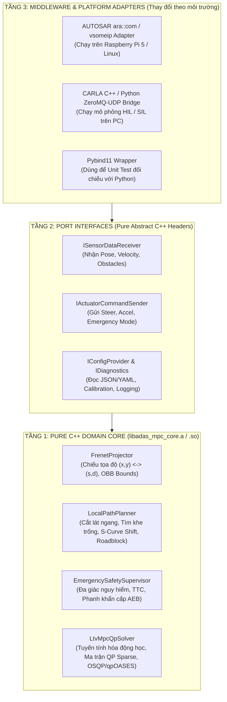
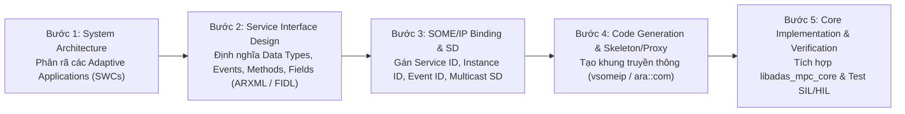
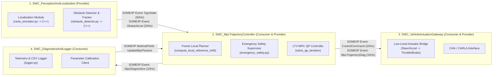

# KẾ HOẠCH CHUYỂN ĐỔI HỆ THỐNG LMPC SANG C++ (LINUX x64 / ARM64 RASPBERRY PI 5) & THIẾT KẾ KIẾN TRÚC PHẦN MỀM CHUẨN AUTOSAR (SOME/IP)

Tài liệu này định nghĩa chi tiết kiến trúc phần mềm, thiết kế dịch vụ truyền thông **AUTOSAR Adaptive (SOME/IP)**, phương pháp chuyển đổi toán học từ **Python (CasADi/IPOPT)** sang **C++17/20 (Eigen3 + OSQP/qpOASES)**, và lộ trình triển khai từng bước từ máy tính **Linux x86_64** sang bo mạch nhúng **Raspberry Pi 5 (ARM64 Cortex-A76)**.

---

## 1. MỤC TIÊU KỸ THUẬT & NGUYÊN LÝ THIẾT KẾ ĐỂ DỄ BẢO TRÌ / NÂNG CẤP

Để đảm bảo hệ thống dễ dàng **bảo trì (Maintainable)**, **mở rộng (Upgradable)** và **chạy đa nền tảng (Cross-platform: x86_64 PC $\leftrightarrow$ ARM64 Raspberry Pi 5)**, kiến trúc phần mềm phải tuân thủ nguyên lý **Clean / Hexagonal Architecture (Ports & Adapters)**:



### 4 Nguyên tắc Cốt lõi giúp Dễ Maintain & Upgrade:
1. **Cô lập tuyệt đối Thuật toán Lõi (`Domain Core`) khỏi Middleware**:
   - Thư viện lõi `libadas_mpc_core` **chỉ sử dụng C++17 chuẩn, `Eigen3` và `OSQP`**. Tuyệt đối không `#include` bất kỳ thư viện mạng, SOME/IP hay CARLA nào vào trong code thuật toán MPC.
   - Khi nâng cấp thuật toán (ví dụ: thêm mô hình động lực học Dynamic Bicycle Model, nâng cấp xử lý vật cản động), bạn chỉ sửa trong `Domain Core` mà không đụng tới code truyền thông AUTOSAR.
2. **Cấu hình Động (Dynamic Configuration & Runtime Calibration)**:
   - Thay thế toàn bộ hằng số cứng trong `src/config.py` bằng bộ nạp cấu hình `ConfigManager` đọc từ file `config.json` / `config.yaml` khi khởi động, kết hợp **SOME/IP Field/Method** cho phép tinh chỉnh trọng số MPC (`FINE_X_COEF`, `OBSTACLE_AVOIDANCE_MARGIN_M`, `OBSTACLE_CAUTION_SPEED_MS`...) ngay khi xe đang chạy mà **không cần biên dịch lại code C++**.
3. **Strategy Pattern cho Bộ giải Tối ưu (`IQpSolverBackend`)**:
   - Đóng gói bộ giải QP sau interface `IQpSolverBackend`. Hiện tại dùng `OSQP`, sau này muốn đổi sang `qpOASES`, `HPIPM` hoặc `Acados` chỉ cần viết thêm 1 class thực thi interface này.
4. **Kiến trúc HIL (Hardware-in-the-Loop) giữa PC và Raspberry Pi 5**:
   - **PC (x86_64)**: Chạy CARLA Simulator + Node xuất dữ liệu cảm biến qua mạng Ethernet (SOME/IP).
   - **Raspberry Pi 5 (ARM64)**: Nhận gói tin SOME/IP từ PC qua cáp mạng LAN Gigabit, chạy toàn bộ thuật toán quy hoạch + MPC C++, và bắn ngược lệnh điều khiển (`Steer`, `Throttle/Brake`) về PC qua SOME/IP.

---

## 2. KIẾN TRÚC PHẦN MỀM CHUẨN AUTOSAR (DESIGN PROCESS & SOME/IP)

Trên nền tảng Linux (Ubuntu / Yocto trên Raspberry Pi 5), hệ thống tuân theo chuẩn **AUTOSAR Adaptive Platform (AP)** sử dụng giao thức truyền thông hướng dịch vụ **SOME/IP (Scalable service-Oriented MiddlewarE over IP)**.

### 2.1. Quy trình Thiết kế theo chuẩn AUTOSAR (AUTOSAR V-Model Design Process)



---

### 2.2. Phân rã các AUTOSAR Adaptive Software Components (SWCs / Executables)

Hệ thống hiện tại trong `src/` được tách thành **4 Adaptive Applications (SWCs)** chạy độc lập và giao tiếp qua SOME/IP:



---

### 2.3. Đặc tả Chi tiết Giao diện Dịch vụ SOME/IP (Service Interfaces, Events, Methods, Fields)

#### A. Service 1: `LocalizationService` (Cung cấp trạng thái xe & lộ trình toàn cục)
- **Service ID**: `0x1001` | **Instance ID**: `0x0001` | **Major/Minor Version**: `1.0`

| Loại phần tử | Tên phần tử | ID | Tầng vận chuyển | Chu kỳ / Kiểu kích hoạt | Mô tả dữ liệu (Payload) |
| :--- | :--- | :--- | :--- | :--- | :--- |
| **Event** | `OnEgoVehicleState` | `0x8001` | UDP | Cyclic `20ms` (50Hz) | `timestamp_us (uint64)`, `x_m (double)`, `y_m (double)`, `yaw_rad (double)`, `v_ms (double)`, `yaw_rate_rads (double)`, `steer_ feedback_rad (double)` |
| **Event** | `OnReferencePathSegment` | `0x8002` | UDP / TCP | Cyclic `100ms` (10Hz) | `start_idx (uint32)`, `horizon_len (uint16)`, mảng `waypoints[N]` gồm `{x_ref, y_ref, theta_ref, v_ref}` |
| **Method** | `RequestGlobalRouteReset` | `0x0001` | TCP | Request / Response | Input: `route_id (uint8)` $\rightarrow$ Output: `result_code (uint8)` |

#### B. Service 2: `ObjectPerceptionService` (Cung cấp bản đồ vật cản cục bộ)
- **Service ID**: `0x1002` | **Instance ID**: `0x0001` | **Major/Minor Version**: `1.0`

| Loại phần tử | Tên phần tử | ID | Tầng vận chuyển | Chu kỳ / Kiểu kích hoạt | Mô tả dữ liệu (Payload) |
| :--- | :--- | :--- | :--- | :--- | :--- |
| **Event** | `OnDetectedObstacles` | `0x8011` | UDP | Cyclic `50ms` (20Hz) | `timestamp_us (uint64)`, `num_obstacles (uint8)`, mảng `obstacles[M]` (tối đa 32 vật cản) |
| **Field** | `SensorDetectionRange` | `0x9001` | UDP | Getter / Setter / Notifier | `detection_range_m (float)` (mặc định `30.0m`), `fov_deg (float)` (`120.0`) |

*Cấu trúc `ObstacleData` (Serialize theo chuẩn SOME/IP mạng):*
```cpp
struct ObstacleData {
    uint32_t id;
    uint8_t  classification; // 0: Unknown, 1: Vehicle, 2: Pedestrian, 3: StaticProp
    uint8_t  is_dynamic;     // 0: Static, 1: Moving
    float    closest_x_m;    // Điểm gần nhất trên bề mặt OBB
    float    closest_y_m;
    float    center_x_m;     // Tâm hộp bao OBB
    float    center_y_m;
    float    extent_x_m;     // Nửa chiều dài OBB
    float    extent_y_m;     // Nửa chiều rộng OBB
    float    box_yaw_rad;    // Góc hướng OBB
    float    vx_ms;          // Vận tốc dọc trục X toàn cục (EMA filtered)
    float    vy_ms;          // Vận tốc dọc trục Y toàn cục
};
```

#### C. Service 3: `MpcMotionControlService` (Dịch vụ điều khiển chuyển động MPC)
- **Service ID**: `0x1003` | **Instance ID**: `0x0001` | **Major/Minor Version**: `1.0`

| Loại phần tử | Tên phần tử | ID | Tầng vận chuyển | Chu kỳ / Kiểu kích hoạt | Mô tả dữ liệu (Payload) |
| :--- | :--- | :--- | :--- | :--- | :--- |
| **Event** | `OnMotionControlCommand` | `0x8021` | UDP | Cyclic `50ms` (20Hz) hoặc `100ms` (10Hz) | `timestamp_us (uint64)`, `sequence_counter (uint16)`, `control_mode (uint8)` (`0: NORMAL_MPC`, `1: ROADBLOCK_STOP`, `2: AEB_EMERGENCY`), `target_wheel_angle_rad (float)`, `target_acceleration_ms2 (float)`, `is_valid (bool)` |
| **Event** | `OnLocalPlannedTrajectory` | `0x8022` | UDP | Cyclic `100ms` (10Hz) | Quỹ đạo dự đoán $N$ bước `x_opt[N+1]`, `y_opt[N+1]`, quỹ đạo dịch làn `x_ref_mod[N]`, `y_ref_mod[N]`, `d_target (float)`, `solve_time_ms (float)`, `qp_cost (float)` |
| **Method** | `SetEmergencyOverride` | `0x0011` | UDP | Request / Response | Cho phép hệ thống giám sát ngoài ép xe dừng khẩn cấp ngay lập tức |
| **Field** | `MpcTuningParameters` | `0x9011` | TCP | Getter / Setter / Notifier | Struct chứa các trọng số `w_x, w_y, w_v, w_theta, w_steer, w_acc, margin_m, road_half_width_m` |

---

## 3. ÁNH XẠ CHUYỂN ĐỔI TỪ PYTHON SANG C++ (MODULE-BY-MODULE MAPPING)

Bảng dưới đây mô tả chi tiết cách chuyển đổi từng file trong `src/` hiện tại sang C++ và các thư viện tương ứng:

| File Python hiện tại | Module C++ tương ứng | Thay đổi kỹ thuật cốt lõi khi sang C++ |
| :--- | :--- | :--- |
| `src/config.py` | `include/core/mpc_config.hpp`<br>`src/core/config_loader.cpp` | Chuyển các hằng số thành `struct MpcConfig`. Đọc từ file `config/mpc_params.json` qua thư viện `nlohmann/json`. Có `std::mutex` bảo vệ khi cập nhật nóng qua SOME/IP. |
| `src/help_functions.py`<br>`src/vehicle_model.py` | `include/core/math_utils.hpp`<br>`include/core/kinematic_model.hpp` | Sử dụng `Eigen::Vector4d` cho trạng thái $X = [x, y, \theta, v]^T$ và `Eigen::Vector2d` cho $U = [\delta, a]^T$. Các hàm `normalizeAngle`, `calculateLateralDeviation` viết dạng `inline constexpr` để trình biên dịch tối ưu hóa. |
| `src/obstacle_detector.py` | `include/perception/obstacle_tracker.hpp`<br>`src/perception/obstacle_tracker.cpp` | Dùng `std::unordered_map<uint32_t, TrackedObstacle>` thay cho `dict` Python. Tính khoảng cách từ điểm tới OBB bằng phép chiếu vector `Eigen::Vector2d`. |
| `src/emergency_safety.py` | `include/core/emergency_safety.hpp`<br>`src/core/emergency_safety.cpp` | Chuyển hàm kiểm tra đa giác vùng nguy hiểm và tính toán TTC sang C++ thuần, trả về `struct SafetyOverrideResult`. |
| `src/linearized_mpc_controller.py` *(Phần Frenet & Slices)* | `include/planning/frenet_projector.hpp`<br>`include/planning/local_path_planner.hpp` | Tách phần quy hoạch cục bộ (`project_to_frenet`, `find_free_gaps_in_corridor`, `select_optimal_shift_from_gaps`, `compute_local_reference_shift`, `compute_safe_speed_profile`) thành class `LocalPathPlanner` độc lập. |
| `src/linearized_mpc_controller.py` *(Phần `solve_qp_iteration`)* | `include/control/ltv_mpc_qp_solver.hpp`<br>`src/control/ltv_mpc_qp_solver.cpp` | **Thay đổi quan trọng nhất**: Loại bỏ `CasADi + IPOPT`, thay bằng bài toán **Sparse Quadratic Programming (QP)** giải bằng thư viện **OSQP** (`osqp-eigen`). |

---

## 4. CÁCH CHUYỂN BỘ GIẢI CASADI (`ca.Opti`) SANG C++ OSQP TỐC ĐỘ CAO

Trong file `src/linearized_mpc_controller.py` hiện tại, mỗi vòng lặp đang khởi tạo đối tượng `opti = ca.Opti()` và gọi bộ giải phi tuyến `ipopt`. Trên Raspberry Pi 5, việc tạo đồ thị ký tự (symbolic graph) của CasADi và gọi IPOPT sẽ tốn `10ms - 25ms`.

Khi chuyển sang C++, bài toán tại mỗi vòng lặp tuyến tính hóa thực chất là một **bài toán Quy hoạch Toàn phương Lồi (Convex Quadratic Programming - QP)** chuẩn:

$$\min_{z} \quad \frac{1}{2} z^T P z + q^T z$$
$$\text{s.t.} \quad l \le A_{\text{qp}} z \le u$$

### Cấu trúc Vector biến tối ưu $z$ trong C++:
Với chân trời dự đoán $N = 10$ và tối đa $M = 3$ vật cản gần nhất:
$$z = \begin{bmatrix} X_0^T, \dots, X_N^T, & U_0^T, \dots, U_{N-1}^T, & \epsilon_{\text{road}, 0}, \dots, \epsilon_{\text{road}, N-1}, & \epsilon_{\text{slack}, 0, 0}, \dots, \epsilon_{\text{slack}, M-1, N-1} \end{bmatrix}^T$$

- Số biến trạng thái $X$: $4 \times (N + 1) = 44$ biến.
- Số biến điều khiển $U$: $2 \times N = 20$ biến.
- Số biến bù mép đường $\epsilon_{\text{road}}$: $N = 10$ biến.
- Số biến bù vật cản $\epsilon_{\text{slack}}$: $3 \times N = 30$ biến.
$\Rightarrow$ **Tổng kích thước vector biến tối ưu $z$ cố định chỉ có $104$ biến!**

### Cách xây dựng Ma trận $P, q, A_{\text{qp}}, l, u$ bằng `Eigen::SparseMatrix`:
1. **Ma trận Hessian $P \in \mathbb{R}^{104 \times 104}$ (Ma trận đường chéo/thưa)**:
   - Tại các vị trí của $X_k$: điền $2 \cdot \text{diag}(w_x, w_y, w_\theta, w_v) + 2 \cdot w_{\text{lat}} \cdot J_{\text{lat}}^T J_{\text{lat}}$.
   - Tại các vị trí của $U_k$: điền $2 \cdot \text{diag}(w_\delta, w_a)$ cộng thêm ma trận sai phân bậc hai của $w_{\Delta \delta} (U_{0,k} - U_{0,k-1})^2$ và $w_{\Delta a} (U_{1,k} - U_{1,k-1})^2$.
   - Tại các vị trí của $\epsilon_{\text{road}, k}$: điền $2 \times 8000.0 = 16000.0$.
   - Tại các vị trí của $\epsilon_{\text{slack}, m, k}$: điền $2 \times \text{MPC\_W\_SLACK} = 40000.0$.
2. **Vector bậc nhất $q \in \mathbb{R}^{104}$**:
   - Tại vị trí $X_k$: điền $-2 \cdot \text{diag}(w_x, w_y, w_\theta, w_v) X_{\text{ref}, k}$.
   - Tại vị trí $\epsilon_{\text{road}, k}$: điền $+800.0$ (thành phần phạt tuyến tính $L_1$).
   - Tại vị trí $\epsilon_{\text{slack}, m, k}$: điền $+\text{MPC\_W\_SLACK\_LINEAR} = +500.0$.
3. **Ma trận ràng buộc tuyến tính $A_{\text{qp}}$ và biên $[l, u]$**:
   - **Ràng buộc 1 (Trạng thái đầu)**: $X_0 = x_{\text{init}}$ ($l = u = x_{\text{init}}$).
   - **Ràng buộc 2 (Động học LTV)**: $X_{k+1} - A_k X_k - B_k U_k = C_k$ ($l = u = C_k$).
   - **Ràng buộc 3 (Giới hạn cơ khí & vận tốc)**: $u_{\min} \le U_k \le u_{\max}$, $v_{\min} \le X_{3, k+1} \le 15.0$.
   - **Ràng buộc 4 (Hành lang mặt đường)**:
     $$n_{x,r} X_{0,k} + n_{y,r} X_{1,k} - \epsilon_{\text{road}, k} \le 5.25 + (n_{x,r} x_{\text{orig},k} + n_{y,r} y_{\text{orig},k})$$
     $$n_{x,r} X_{0,k} + n_{y,r} X_{1,k} + \epsilon_{\text{road}, k} \ge -5.25 + (n_{x,r} x_{\text{orig},k} + n_{y,r} y_{\text{orig},k})$$
   - **Ràng buộc 5 (Siêu phẳng vật cản)**:
     $$n_{x,\text{bar}} X_{0,k} + n_{y,\text{bar}} X_{1,k} + \epsilon_{\text{slack}, m, k} \ge r_{\text{safe}} + n_{x,\text{bar}} x_o + n_{y,\text{bar}} y_o$$

> [!TIP]
> **Hiệu năng đạt được**: Do cấu trúc vị trí các phần tử khác 0 (sparsity pattern) của ma trận $P$ và $A_{\text{qp}}$ không đổi, trong C++ bạn chỉ cần cấp phát bộ nhớ **1 lần duy nhất trong hàm khởi tạo (`constructor`)**, và dùng hàm `osqp_update_lin_cost` / `osqp_update_A` ở mỗi chu kỳ điều khiển. Thời gian giải trên Raspberry Pi 5 chỉ mất **$\approx 0.3\,\text{ms} - 0.8\,\text{ms}$** (nhanh gấp **30 lần** so với Python!), hoàn toàn không có cấp phát bộ nhớ động (`malloc/new`) trong vòng lặp thời gian thực.

---

## 5. CẤU TRÚC THƯ MỤC DỰ ÁN C++ ĐỀ XUẤT

```text
cpp_autosar_mpc/
├── CMakeLists.txt                      # Cấu hình build tổng, hỗ trợ x86_64 và cross-compile ARM64
├── cmake/
│   └── toolchain-rpi5-aarch64.cmake    # Toolchain biên dịch chéo từ PC sang Raspberry Pi 5
├── config/
│   ├── mpc_parameters.json             # Toàn bộ thông số chuyển từ src/config.py
│   ├── vsomeip_local_pc.json           # Cấu hình SOME/IP chạy thử nghiệm trên 1 máy PC
│   └── vsomeip_hil_rpi5.json           # Cấu hình SOME/IP giữa PC (CARLA) và Raspberry Pi 5
├── arxml/
│   └── AdasMpcSystemManifest.arxml     # Đặc tả AUTOSAR Service Interface & SOME/IP Deployment
├── include/
│   ├── core/
│   │   ├── data_types.hpp              # Các struct chuẩn: EgoState, Obstacle, Trajectory, MpcConfig
│   │   ├── math_utils.hpp              # normalize_angle, lateral_deviation
│   │   ├── kinematic_model.hpp         # Mô hình xe đạp động học & Jacobian A_k, B_k, C_k
│   │   ├── frenet_projector.hpp        # Chiếu tọa độ Frenet & tính OBB bounds
│   │   ├── local_path_planner.hpp      # Cắt lát ngang, tìm khe trống, S-Curve shift, Roadblock
│   │   ├── emergency_safety.hpp        # Vùng nguy hiểm TTC & phanh khẩn cấp AEB
│   │   └── ltv_mpc_qp_solver.hpp       # Bộ giải QP-MPC sử dụng Eigen3 + OSQP
│   ├── interfaces/
│   │   ├── i_middleware_adapter.hpp    # Pure Abstract Interface cho truyền thông
│   │   └── i_qp_solver_backend.hpp     # Interface trừu tượng hóa bộ giải QP
│   └── middleware/
│       └── someip_mpc_adapter.hpp      # Adapter kết nối vsomeip / ara::com
├── src/
│   ├── core/                           # Toàn bộ mã nguồn C++ của libadas_mpc_core
│   ├── middleware/                     # Mã nguồn truyền thông SOME/IP
│   ├── apps/
│   │   ├── swc_mpc_controller_main.cpp # Executable 1: AUTOSAR Adaptive App chạy MPC (trên Pi 5)
│   │   └── swc_carla_someip_bridge.cpp # Executable 2: Cầu nối CARLA <-> SOME/IP (trên PC)
│   └── python_bindings/
│       └── pybind_mpc_core.cpp         # Binding C++ sang Python để chạy test đối chiếu trong CARLA
└── tests/
    ├── test_frenet_and_gaps.cpp        # Unit test cắt lát & tìm khe trống
    ├── test_roadblock_scenarios.cpp    # Unit test các testcase chặn đường
    └── test_qp_solver_accuracy.cpp     # So sánh sai số giữa C++ OSQP và Python CasADi
```

---

## 6. LỘ TRÌNH THỰC HIỆN CHI TIẾT (6 GIAI ĐOẠN - STEP-BY-STEP PLAN)

### Giai đoạn 1: Dựng khung dự án CMake Đa nền tảng & Môi trường (Tuần 1)
1. **Cài đặt thư viện trên Linux x86_64 (PC)**:
   - `sudo apt install build-essential cmake libeigen3-dev nlohmann-json3-dev libboost-system-dev libboost-thread-dev libboost-log-dev pybind11-dev libgtest-dev`
   - Biên dịch và cài đặt `osqp` và `osqp-eigen` (hoặc tích hợp qua `FetchContent` trong `CMakeLists.txt`).
   - Biên dịch `COVESA vsomeip` (thư viện SOME/IP mã nguồn mở chuẩn cho Linux/AUTOSAR).
2. **Thiết lập Cross-Compilation cho Raspberry Pi 5 (ARM64)**:
   - Viết file `cmake/toolchain-rpi5-aarch64.cmake` dùng trình biên dịch `aarch64-linux-gnu-g++` với cờ tối ưu hóa kiến trúc Pi 5: `-O3 -mcpu=cortex-a76 -mtune=cortex-a76 -ftree-vectorize`.

### Giai đoạn 2: Chuyển đổi Tầng Quy hoạch Frenet & An toàn Khẩn cấp sang C++ (Tuần 2)
1. Chuyển đổi các hàm trong `help_functions.py`, `vehicle_model.py`, `emergency_safety.py` sang C++.
2. Chuyển đổi phần Frenet & Local Reference Shift (`project_to_frenet`, `compute_obstacle_frenet_bounds`, `find_free_gaps_in_corridor`, `select_optimal_shift_from_gaps`, `compute_local_reference_shift`, `compute_safe_speed_profile`) sang class `LocalPathPlanner` trong C++.
3. **Kiểm thử đối chiếu ngay lập tức (Zero-Regression Verification)**:
   - Dùng `pybind11` đóng gói `LocalPathPlanner` C++ thành module Python `adas_mpc_cpp`.
   - Trong `src/main.py` hiện tại, gọi song song hàm Python và hàm C++ trên cùng một testcase vật cản để kiểm tra $d_{\text{target}}$, `is_roadblock`, và `x_ref_mod` khớp nhau tuyệt đối ($< 10^{-6}$).

### Giai đoạn 3: Chuyển đổi Bộ giải QP-MPC bằng Eigen3 + OSQP (Tuần 3)
1. Cài đặt class `LtvMpcQpSolver` thiết lập ma trận thưa $P, q, A_{\text{qp}}, l, u$ cho bài toán QP 104 biến.
2. Tích hợp vòng lặp tuyến tính hóa lặp (`MPC_MAX_LINEARIZATION_ITER = 2`) và cơ chế giữ nghiệm Warm-start `x_nom, u_nom`.
3. Chạy thử nghiệm trực tiếp trong CARLA thông qua `pybind11` thay thế hoàn toàn `linearized_mpc_controller.py`. Đo đạc thời gian giải trên PC (mục tiêu $< 0.3\,\text{ms}$) và kiểm tra xe vượt qua toàn bộ các kịch bản né trái, né phải, vật cản so le và dừng khẩn cấp Roadblock.

### Giai đoạn 4: Định nghĩa AUTOSAR Service Interface & Tích hợp SOME/IP (Tuần 4)
1. Viết file cấu hình dịch vụ SOME/IP (`vsomeip_local_pc.json`) định nghĩa các Service `0x1001` (Localization), `0x1002` (Perception), `0x1003` (MPC Control).
2. Xây dựng `SomeipMpcAdapter` đóng vai trò:
   - **SOME/IP Client (Consumer)**: Đăng ký nhận (`Subscribe`) Event `0x8001` (EgoState), `0x8002` (ReferencePath), `0x8011` (DetectedObstacles).
   - **SOME/IP Server (Provider)**: Xuất bản (`OfferService` & `Notify`) Event `0x8021` (ControlCommand) và `0x8022` (PlannedTrajectory).
3. Viết script/node cầu nối phía CARLA (`CarlaSomeipBridge`) để phát dữ liệu từ CARLA lên bus SOME/IP và nhận lệnh điều khiển từ MPC áp dụng vào xe Ego.

### Giai đoạn 5: Triển khai HIL trên Raspberry Pi 5 (Tuần 5)
1. Biên dịch thực thi `swc_mpc_controller` cho kiến trúc `aarch64` và copy sang Raspberry Pi 5.
2. Kết nối Raspberry Pi 5 với PC chạy CARLA qua mạng Gigabit Ethernet (ví dụ: PC IP `192.168.10.10`, Raspberry Pi 5 IP `192.168.10.20`).
3. Bật tính năng **SOME/IP Service Discovery (SOME/IP-SD)** qua địa chỉ Multicast `224.224.224.245:30490`.
4. Khởi chạy `swc_mpc_controller` trên Raspberry Pi 5 và chạy mô phỏng CARLA trên PC:
   - Giám sát độ trễ truyền thông mạng (Round-trip latency qua Ethernet thường $< 1.0\,\text{ms}$).
   - Giám sát tải CPU và thời gian giải QP trên Raspberry Pi 5.

### Giai đoạn 6: Đóng gói chuẩn AUTOSAR Adaptive (Execution, Health & Calibration) (Tuần 6)
1. **Execution Management**: Bổ sung xử lý tín hiệu vòng đời `SIGTERM`/`SIGINT` và báo cáo trạng thái hoạt động.
2. **Platform Health Management (Watchdog)**: Đặt bộ đếm thời gian giám sát (Deadline Supervision) cho chu kỳ điều khiển $100\,\text{ms}$. Nếu dữ liệu cảm biến bị đứt quá $150\,\text{ms}$ (Timeout), tự động chuyển sang trạng thái an toàn (Fail-Safe Braking).
3. **Runtime Calibration**: Cho phép thay đổi tham số cấu hình từ xa qua SOME/IP Field `0x9011` và lưu log chẩn đoán thời gian thực.
