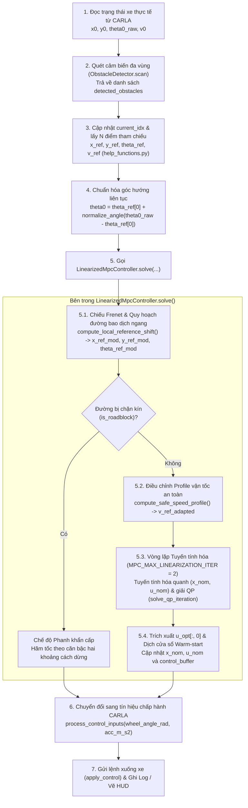
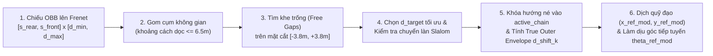

# TÀI LIỆU KỸ THUẬT CHI TIẾT: HỆ THỐNG ĐIỀU KHIỂN LINEARIZED MPC & NÉ VẬT CẢN TRÊN CARLA

Tài liệu này phân tích toàn diện mã nguồn của dự án **CARLA Autonomous MPC**, giải thích chi tiết từ kiến trúc tổng thể, luồng hoạt động của bộ điều khiển **Linearized MPC (`LinearizedMpcController`)**, cấu trúc **Input / Output**, **Hàm chi phí (Cost Function)**, **Quy trình nhận thức & xử lý né vật cản**, cho đến ý nghĩa của toàn bộ các bộ thông số trong **`src/config.py`**.

---

## MỤC LỤC
1. [Tổng quan Kiến trúc Mã nguồn](#1-tổng-quan-kiến-trúc-mã-nguồn)
2. [Luồng Hoạt động Chi tiết của Hệ thống & Bộ Linearized MPC](#2-luồng-hoạt-động-chi-tiết-của-hệ-thống--bộ-linearized-mpc)
3. [Chi tiết Input và Output của Bộ điều khiển Linearized MPC](#3-chi-tiết-input-và-output-của-bộ-điều-khiển-linearized-mpc)
4. [Mô hình Động học & Thuật toán Tuyến tính hóa Lặp (LTV-MPC)](#4-mô-hình-động-học--thuật-toán-tuyến-tính-hóa-lặp-ltv-mpc)
5. [Giải thích Chi tiết Hàm Chi phí (Cost Function) & Hệ Ràng buộc](#5-giải-thích-chi-tiết-hàm-chi-phí-cost-function--hệ-ràng-buộc)
6. [Quá trình Phát hiện Vật cản & Thuật toán Xử lý Né Đa Tình huống](#6-quá-trình-phát-hiện-vật-cản--thuật-toán-xử-lý-né-đa-tình-huống)
7. [Giải thích Chi tiết Toàn bộ Thông số trong `src/config.py`](#7-giải-thích-chi-tiết-toàn-bộ-thông-số-trong-srcconfigpy)

---

## 1. Tổng quan Kiến trúc Mã nguồn

Hệ thống được thiết kế theo kiến trúc phân tầng chuẩn của xe tự hành (**Perception $\to$ Local Planning $\to$ MPC Control $\to$ Actuation**):

| File mã nguồn | Vai trò chính trong hệ thống |
| :--- | :--- |
| `src/main.py` | Vòng lặp điều khiển chính (10Hz): kết nối CARLA, đọc trạng thái xe, gọi cảm biến quét vật cản, trích xuất quỹ đạo tham chiếu, gọi MPC giải bài toán tối ưu và gửi tín hiệu điều khiển xuống xe. |
| `src/config.py` | Trung tâm lưu trữ toàn bộ hằng số cấu hình: tham số xe, trọng số MPC, cấu hình cảm biến, hình học S-Curve né vật cản, điều tốc và hiển thị đồ họa. |
| `src/linearized_mpc_controller.py` | **Bộ điều khiển cốt lõi**: Tích hợp bộ quy hoạch đường bao né vật cản cục bộ trên hệ tọa độ Frenet, bộ điều tốc an toàn (Adaptive Speed Governor), xử lý phanh khẩn cấp khi tắc đường (Roadblock Stop) và bộ giải **Successive Linearization QP-MPC** có biến bù mềm (Slack Variables). |
| `src/mpc_controller.py` | Bộ điều khiển NMPC phi tuyến cơ sở (chỉ dùng khi tắt cờ `USE_LINEARIZED_QP_MPC = False` để chạy thuần bám đường). |
| `src/obstacle_detector.py` | Hệ thống nhận thức vật cản ảo gắn trên xe Ego: tính điểm gần nhất trên hộp bao định hướng 2D (OBB), quét đa vùng (FOV $120^\circ$ phía trước + $360^\circ$ cự ly gần) và duy trì bản đồ vật cản có nhớ (`tracked_obstacles`). |
| `src/help_functions.py` | Các hàm bổ trợ toán học & quỹ đạo: đọc file CSV (`load_csv_trajectory`), tìm waypoint gần nhất (`update_reference_point`), trích xuất $N$ điểm tham chiếu phía trước (`get_ref_trajectory`) và tính khoảng cách lệch ngang (`calculate_lateral_deviation`). |
| `src/vehicle_model.py` | Định nghĩa phương trình động học xe đạp (Kinematic Bicycle Model) dùng cho CasADi. |
| `src/carla_simulator.py` | Giao tiếp với CARLA Server: spawn xe, lấy trạng thái `(x, y, theta, v)`, chuyển đổi `(wheel_angle, acceleration)` thành `(steer, throttle, brake)` và vẽ đồ họa 3D debug. |
| `src/create_obstacles/obstacle_generator.py` | Quản lý sinh vật cản tĩnh từ file cố định `data/obstacles.csv` hoặc sinh ngẫu nhiên theo cụm dọc theo quỹ đạo. |
| `src/camera_viewer.py` | Cửa sổ Pygame độc lập hiển thị hình ảnh từ camera gắn trên xe kèm bảng thông số HUD thời gian thực. |
| `src/logger.py` | Ghi nhận dữ liệu theo từng chu kỳ điều khiển và xuất 6 biểu đồ đánh giá chất lượng điều khiển vào thư mục `plots/`. |

---

## 2. Luồng Hoạt động Chi tiết của Hệ thống & Bộ Linearized MPC

### 2.1. Sơ đồ tổng thể vòng lặp điều khiển chính (`src/main.py`)

Ở mỗi chu kỳ lấy mẫu $\Delta t = 0.1\text{s}$ (tần số $10\text{Hz}$), hệ thống thực hiện tuần tự 7 bước khép kín:



### 2.2. Giải thích từng bước trong `LinearizedMpcController.solve()`

Khi hàm `mpc_controller.solve(x_init, x_ref, y_ref, theta_ref, v_ref, detected_obstacles)` được gọi tại dòng 133 của `src/main.py`:

1. **Bước 1 — Tạo quỹ đạo tham chiếu cục bộ đã dịch né (`compute_local_reference_shift`)**:
   - Từ quỹ đạo gốc `(x_ref, y_ref, theta_ref)` dài $N = 10$ bước và danh sách vật cản `detected_obstacles`, bộ điều khiển chiếu toàn bộ vật cản lên hệ tọa độ Frenet `(s, d)` dọc theo tim đường.
   - Tìm khe trống khả dụng trên mặt đường, xác định hướng né (trái/phải) và biên độ dịch ngang mục tiêu $d_{\text{target}}$.
   - Áp dụng hàm trọng số hình chuông S-Curve (`calc_span_obstacle_weight`) để uốn mượt quỹ đạo gốc thành quỹ đạo tham chiếu mới `(x_ref_mod, y_ref_mod, theta_ref_mod)`. Nếu không có vật cản, quỹ đạo mới trùng khít với quỹ đạo gốc.
2. **Bước 2 — Kiểm tra phong tỏa đường (`is_roadblock`)**:
   - Nếu cả hai bên trái và phải của làn đường đều bị vật cản chặn kín (không có khe trống nào đủ cho bề rộng thân xe), cờ `self.is_roadblock = True` được bật.
   - Bộ điều khiển lập tức chuyển sang chế độ **Phanh dừng khẩn cấp an toàn**: hạ ngưỡng vận tốc tối thiểu `min_v = 0.0`, tạo profile giảm tốc êm theo công thức động học $v_{\text{target}}(k) = \sqrt{2 \cdot a_{\text{dec}} \cdot d_{\text{stop}}(k)}$ và dừng xe cách chướng ngại vật một khoảng an toàn `ROADBLOCK_SAFE_STOP_DISTANCE_M = 3.5m`.
3. **Bước 3 — Điều chỉnh vận tốc an toàn (`compute_safe_speed_profile`)**:
   - Khi đang tiếp cận, đi ngang qua, hoặc vừa thoát khỏi vật cản, hàm này tự động hạ mượt vận tốc tham chiếu từ `TARGET_SPEED_MS` ($10.0\text{ m/s}$) xuống `OBSTACLE_CAUTION_SPEED_MS` ($5.0\text{ m/s}$), giúp giảm lực ly tâm khi đánh lái chuyển làn.
4. **Bước 4 — Khởi tạo hoặc duy trì quỹ đạo danh định Warm-Start (`self.x_nom`, `self.u_nom`)**:
   - Ở chu kỳ đầu tiên khi xe mới xuất phát (`self.x_nom is None`), hàm `init_nominal_trajectory()` khởi tạo quỹ đạo dự đoán danh định dọc theo `x_ref_mod`.
   - Ở tất cả các chu kỳ tiếp theo, hệ thống giữ nguyên nghiệm dự đoán từ bước trước làm điểm tựa tuyến tính hóa để đảm bảo tính liên tục, không bị giật góc lái.
5. **Bước 5 — Vòng lặp Tuyến tính hóa liên tiếp (`MPC_MAX_LINEARIZATION_ITER = 2` vòng)**:
   - Tại mỗi vòng lặp `it`:
     - Tuyến tính hóa mô hình xe phi tuyến quanh quỹ đạo danh định hiện tại `(self.x_nom, self.u_nom)` để thu được hệ phương trình trạng thái tuyến tính biến thiên theo thời gian (LTV): $X_{k+1} = A_k X_k + B_k U_k + d_k$.
     - Thiết lập các siêu phẳng ngăn cách vật cản tuyến tính hóa quanh `self.x_nom[:, k]`.
     - Giải bài toán Quy hoạch Toàn phương (QP) bằng IPOPT trong `solve_qp_iteration()`.
     - Cập nhật nghiệm vừa tìm được `x_opt, u_opt` ngược lại vào `self.x_nom, self.u_nom` để vòng lặp tiếp theo tuyến tính hóa chính xác hơn.
6. **Bước 6 — Trích xuất tín hiệu điều khiển & Dịch chuyển chân trời dự đoán (Horizon Shifting)**:
   - Lấy phần tử điều khiển đầu tiên `steer_rad = u_opt[0, 0]` và `acc_m_s2 = u_opt[1, 0]` để xuất ra ngoài.
   - Lưu chuỗi điều khiển còn lại `u_opt[:, 1:]` vào `self.control_buffer` (dùng làm phao cứu sinh nếu ở chu kỳ sau bộ giải gặp sự cố quá thời gian).
   - Dịch trái `self.x_nom` và `self.u_nom` đi 1 bước thời gian (`self.x_nom[:, :-1] = x_opt[:, 1:]`) để làm Warm-start chuẩn xác cho chu kỳ kế tiếp.

---

## 3. Chi tiết Input và Output của Bộ điều khiển Linearized MPC

### 3.1. Đầu vào (Inputs) của hàm `LinearizedMpcController.solve()`

Hàm `solve(self, x_init, x_ref, y_ref, theta_ref, v_ref, detected_obstacles=None)` nhận 6 tham số đầu vào tại mỗi chu kỳ $100\text{ms}$:

| Tên biến Input | Kiểu dữ liệu & Kích thước | Đơn vị | Nguồn cung cấp & Ý nghĩa chi tiết |
| :--- | :--- | :--- | :--- |
| **`x_init`** | `np.ndarray` shape `(4,)` | $[\text{m}, \text{m}, \text{rad}, \text{m/s}]$ | Vector trạng thái thực tế hiện tại của xe Ego: $[x_0, y_0, \theta_0, v_0]^T$. Trong đó $(x_0, y_0)$ là tọa độ tâm xe trong hệ tọa độ thế giới CARLA, $v_0 = \sqrt{v_x^2 + v_y^2}$ là tốc độ dài, và $\theta_0$ là góc hướng (yaw) **đã được làm liên tục hóa (unwrapped)** theo `theta_ref[0]`. |
| **`x_ref`** | `np.ndarray` shape `(N,)` | $\text{m}$ | Tọa độ $X$ của $N = 10$ waypoint tham chiếu phía trước tính từ vị trí hiện tại của xe (`x_ref[0]` ứng với $t = 0$, `x_ref[k]` ứng với $t = k \cdot \Delta t$). Khoảng cách giữa 2 điểm liên tiếp trong `x_ref` tự động co giãn theo tốc độ tham chiếu: $\Delta s = \max(v_{\text{traj}}, 2.0) \cdot \Delta t$. |
| **`y_ref`** | `np.ndarray` shape `(N,)` | $\text{m}$ | Tọa độ $Y$ của $N = 10$ waypoint tham chiếu phía trước tương ứng với `x_ref`. |
| **`theta_ref`** | `np.ndarray` shape `(N,)` | $\text{rad}$ | Góc tiếp tuyến của đường đi tại $N$ điểm tham chiếu. Đã được xử lý bằng `np.unwrap` khi đọc CSV để không bị nhảy bậc từ $+\pi$ sang $-\pi$. |
| **`v_ref`** | `np.ndarray` shape `(N,)` | $\text{m/s}$ | Vận tốc mục tiêu tại $N$ điểm tham chiếu phía trước (tối đa bằng `TARGET_SPEED_MS = 10.0 m/s` trên đoạn thẳng và tự động giảm tại các khúc cua gắt). |
| **`detected_obstacles`** | `list[dict]` (độ dài $M_{\text{raw}}$) | Đa đơn vị | Danh sách các từ điển thông tin vật cản do `ObstacleDetector.scan()` trả về. Mỗi phần tử chứa: `'id'`, `'x'`, `'y'` (điểm bề mặt gần nhất), `'center_x'`, `'center_y'`, `'extent_x'`, `'extent_y'`, `'box_yaw'`, `'dist'`, `'d_long'`, `'d_lat'`, `'radius'`, `'source'`. |

> **Lưu ý kỹ thuật quan trọng về xử lý góc $\theta_0$ trước khi đưa vào Input (`src/main.py` dòng 124)**:
> Cảm biến IMU/Odometry của CARLA trả về `theta0_raw` nằm trong khoảng $[-\pi, \pi]$, trong khi `theta_ref` đã được `np.unwrap` nên có thể mang giá trị vượt ngoài $[-\pi, \pi]$ (ví dụ $+3.5\text{ rad}$ khi xe quay hơn nửa vòng). Do đó, dòng lệnh:
> ```python
> theta0 = theta_ref[0] + normalize_angle(theta0_raw - theta_ref[0])
> ```
> giúp đặt `theta0` vào **đúng cùng một nhánh góc liên tục** với `theta_ref[0]`, giúp hiệu số $(X[2, k] - \theta_{\text{ref}}[k])$ trong hàm chi phí luôn là độ lệch góc thực sự nhỏ nhất mà không bao giờ bị vọt $2\pi\text{ rad}$ ($360^\circ$).

---

### 3.2. Biến quyết định nội bộ (Internal Decision Variables) trong Bộ giải QP

Bên trong `solve_qp_iteration()`, bài toán tối ưu hóa khởi tạo các biến quyết định sau trên không gian CasADi `Opti`:

1. **Ma trận Trạng thái dự đoán $X \in \mathbb{R}^{4 \times (N+1)}$**:
   $$X = \begin{bmatrix} x_0 & x_1 & \dots & x_N \\ y_0 & y_1 & \dots & y_N \\ \theta_0 & \theta_1 & \dots & \theta_N \\ v_0 & v_1 & \dots & v_N \end{bmatrix}$$
   Kích thước $4 \times 11$ (với $N = 10$). Cột $k = 0$ bị khóa cứng vào trạng thái đo thực tế $X_{:, 0} = x_{\text{init}}$.
2. **Ma trận Tín hiệu Điều khiển dự đoán $U \in \mathbb{R}^{2 \times N}$**:
   $$U = \begin{bmatrix} \delta_0 & \delta_1 & \dots & \delta_{N-1} \\ a_0 & a_1 & \dots & a_{N-1} \end{bmatrix}$$
   Kích thước $2 \times 10$. Hàng 0 là góc bánh lái trước $\delta_k \in [-\delta_{\max}, \delta_{\max}]$ ($\text{rad}$), hàng 1 là gia tốc dọc $a_k \in [a_{\min}, a_{\max}]$ ($\text{m/s}^2$).
3. **Ma trận Biến bù nới lỏng (Slack Variables) $\varepsilon_{\text{slack}} \in \mathbb{R}^{M \times N}_{\ge 0}$**:
   - Chỉ được tạo khi có $M \in \{1, 2\}$ vật cản hoạt động phía trước mũi xe.
   - Đảm bảo bài toán QP **luôn luôn có nghiệm khả thi (recursively feasible)** ngay cả khi xe đi vào vùng hẹp sát vật cản.

---

### 3.3. Đầu ra (Outputs) của Bộ điều khiển & Hậu xử lý Tín hiệu Chấp hành

1. **Đầu ra trực tiếp của `LinearizedMpcController.solve()`**:
   Trả về bộ 2 giá trị vật lý tại bước thời gian hiện tại ($k = 0$):
   - **`steer_rad`** ($\delta_0^* = U[0, 0]$, đơn vị $\text{rad}$): Góc bẻ bánh lái trước tối ưu. Giới hạn trong $[-1.2217, +1.2217]\text{ rad}$ ($\pm 70^\circ$).
   - **`acc_m_s2`** ($a_0^* = U[1, 0]$, đơn vị $\text{m/s}^2$): Gia tốc dọc tối ưu. Giới hạn trong $[-4.1, +10.0]\text{ m/s}^2$.
   - Ngoài ra, bộ điều khiển cập nhật thuộc tính `self.x_ref_mod`, `self.y_ref_mod` (để hiển thị vệt đường dự đoán màu đỏ trên CARLA) và `self.last_cost` ($J^*$, giá trị hàm chi phí tối ưu).

2. **Chuyển đổi sang lệnh điều khiển xe CARLA (`CarlaSimulator.process_control_inputs` tại `src/carla_simulator.py` dòng 193–212)**:
   - **Chống trượt bánh khi khởi hành (Traction Control)**: Nếu vận tốc hiện tại `current_speed < 1.5 m/s`, gia tốc yêu cầu bị kẹp trần `min(acc_m_s2, 2.5)` để xe tăng tốc êm, không bị xoáy bánh sau.
   - **Tách kênh Ga (`throttle`) và Phanh (`brake`)**:
     - Nếu `acc_m_s2 > 0`:
       $$\text{throttle} = \min\left(\frac{a_0^*}{a_{\max}}, 1.0\right), \quad \text{brake} = 0.0$$
     - Nếu `acc_m_s2 <= 0`:
       $$\text{throttle} = 0.0, \quad \text{brake} = \begin{cases} \min\left(\left|\frac{a_0^*}{a_{\text{brake, max}}}\right|, 0.15\right) & \text{nếu } v_0 < 2.5\text{ m/s và } a_0^* \ge -1.5\text{ m/s}^2 \\ \min\left(\left|\frac{a_0^*}{a_{\text{brake, max}}}\right|, 1.0\right) & \text{ngược lại} \end{cases}$$
       *(Mẹo kỹ thuật: Giới hạn phanh ở mức `0.15` khi xe đi chậm và chỉ cần giảm tốc nhẹ giúp xe CARLA không bị khựng khóa cứng bánh).*
   - **Chuẩn hóa góc lái (`steer`)**:
     $$\text{steer} = \text{clip}\left(\frac{\delta_0^*}{\delta_{\max}}, -1.0, +1.0\right)$$

---

## 4. Mô hình Động học & Thuật toán Tuyến tính hóa Lặp (LTV-MPC)

### 4.1. Mô hình Động học Xe đạp Phi tuyến Rời rạc (`_eval_discrete_dynamics`)

Xe được mô hình hóa bằng phương trình Kinematic Bicycle Model rời rạc hóa Euler tiến với chu kỳ $\Delta t = 0.1\text{s}$ và chiều dài cơ sở $L = 2.875\text{m}$:

$$x_{k+1} = f(x_k, u_k) = \begin{bmatrix} p_{x, k} + v_k \cos(\theta_k) \Delta t \\ p_{y, k} + v_k \sin(\theta_k) \Delta t \\ \theta_k + \frac{v_k}{L} \tan(\delta_k) \Delta t \\ v_k + a_k \Delta t \end{bmatrix}$$

### 4.2. Tuyến tính hóa Taylor Bậc 1 quanh Quỹ đạo Danh định (`get_linearized_matrices`)

Vì hàm $f(x_k, u_k)$ chứa các thành phần phi tuyến $\cos(\theta_k)$, $\sin(\theta_k)$ và $\tan(\delta_k)$, bộ điều khiển thực hiện khai triển chuỗi Taylor bậc 1 tại mỗi bước dự đoán $k \in \{0, \dots, N-1\}$ xung quanh điểm danh định $(\bar{x}_k, \bar{u}_k) = (\text{x\_nom}[:, k], \text{u\_nom}[:, k])$:

$$x_{k+1} \approx f(\bar{x}_k, \bar{u}_k) + \underbrace{\left.\frac{\partial f}{\partial x}\right|_{(\bar{x}_k, \bar{u}_k)}}_{A_k} (x_k - \bar{x}_k) + \underbrace{\left.\frac{\partial f}{\partial u}\right|_{(\bar{x}_k, \bar{u}_k)}}_{B_k} (u_k - \bar{u}_k)$$

Rút gọn lại dưới dạng phương trình tuyến tính affine chuẩn (dòng 158–160 của `src/linearized_mpc_controller.py`):

$$X_{:, k+1} = A_k X_{:, k} + B_k U_{:, k} + d_k$$

Trong đó:
- **Ma trận chuyển trạng thái $A_k \in \mathbb{R}^{4 \times 4}$**:
  $$A_k = \begin{bmatrix} 1 & 0 & -\bar{v}_k \sin(\bar{\theta}_k)\Delta t & \cos(\bar{\theta}_k)\Delta t \\ 0 & 1 & \bar{v}_k \cos(\bar{\theta}_k)\Delta t & \sin(\bar{\theta}_k)\Delta t \\ 0 & 0 & 1 & \frac{\tan(\bar{\delta}_k)}{L}\Delta t \\ 0 & 0 & 0 & 1 \end{bmatrix}$$
- **Ma trận điều khiển $B_k \in \mathbb{R}^{4 \times 2}$**:
  $$B_k = \begin{bmatrix} 0 & 0 \\ 0 & 0 \\ \frac{\bar{v}_k}{L \cos^2(\bar{\delta}_k)}\Delta t & 0 \\ 0 & \Delta t \end{bmatrix}$$
  *(Trong code sử dụng `sec_delta_sq = 1.0 / (cos_delta ** 2 + 1e-6)` để chống chia cho 0).*
- **Vector phần dư tuyến tính hóa (Affine Offset) $d_k \in \mathbb{R}^{4}$**:
  $$d_k = f(\bar{x}_k, \bar{u}_k) - (A_k \bar{x}_k + B_k \bar{u}_k)$$
  Nhờ có số hạng $d_k$, tại đúng điểm danh định $(X_k = \bar{x}_k, U_k = \bar{u}_k)$, vế phải hoàn toàn trùng khít với nghiệm động học phi tuyến chính xác $f(\bar{x}_k, \bar{u}_k)$ (không có sai số cắt cụt tại điểm làm việc).

---

## 5. Giải thích Chi tiết Hàm Chi phí (Cost Function) & Hệ Ràng buộc

### 5.1. Công thức Tổng quát của Hàm Chi phí $J$

Tại mỗi vòng lặp giải QP (`solve_qp_iteration`, dòng 564–629), hàm mục tiêu $J(X, U, \varepsilon_{\text{slack}})$ là một hàm bậc hai lồi (Convex Quadratic Cost) tổng hợp trên toàn bộ chân trời dự đoán $N = 10$ bước:

$$J = \sum_{k=0}^{N-1} \Big( J_{x,k} + J_{y,k} + J_{v,k} + J_{\theta,k} + J_{\text{lat},k} + J_{\delta,k} + J_{a,k} + J_{\Delta\delta,k} + J_{\Delta a,k} \Big) + \sum_{m=0}^{M-1} \sum_{k=0}^{N-1} J_{\text{slack}, m, k}$$

### 5.2. Bảng Phân tích Chi tiết 10 Thành phần trong Hàm Chi phí

| STT | Ký hiệu toán học | Công thức trong Code (`solve_qp_iteration`) | Trọng số (`config.py`) | Ý nghĩa Vật lý & Tác dụng Điều khiển |
| :-: | :--- | :--- | :--- | :--- |
| **1** | $J_{x,k}$ | `FINE_X_COEF * (X[0, k] - x_ref[k])**2` | `FINE_X_COEF = 20.0` | **Phạt sai số tọa độ dọc/ngang theo trục $X$ toàn cục**: Giữ vị trí dự đoán $X[0, k]$ tại thời điểm $t = k\Delta t$ bám sát điểm tham chiếu $x_{\text{ref}}[k]$. |
| **2** | $J_{y,k}$ | `FINE_Y_COEF * (X[1, k] - y_ref[k])**2` | `FINE_Y_COEF = 20.0` | **Phạt sai số tọa độ theo trục $Y$ toàn cục**: Kết hợp với $J_{x,k}$ tạo thành lực hút đẳng hướng kéo tâm xe về đúng điểm waypoint mục tiêu $(x_{\text{ref}}[k], y_{\text{ref}}[k])$ theo đúng tiến độ thời gian. |
| **3** | $J_{v,k}$ | `FINE_V_COEF * (X[3, k] - v_ref[k])**2` | `FINE_V_COEF = 25.0` | **Phạt sai số vận tốc dài**: Ép tốc độ xe bám theo profile vận tốc thích ứng `v_ref_adapted[k]` (tăng tốc lên $10\text{ m/s}$ khi đường thoáng và giảm tốc xuống $5\text{ m/s}$ khi qua vật cản). |
| **4** | $J_{\theta,k}$ | `FINE_THETA_COEF * (X[2, k] - theta_ref[k])**2` | `FINE_THETA_COEF = 35.0` | **Phạt sai số góc hướng (Heading Error)**: Giữ mũi xe song song với tiếp tuyến đường đi $\theta_{\text{ref}}[k]$. Trọng số `35.0` đóng vai trò như một **bộ giảm chấn góc (yaw damper)** ngăn không cho mũi xe cắt chéo qua tim đường quá gắt khi nhập làn. |
| **5** | $J_{\text{lat},k}$ | `FINE_LATERAL_COEF * (lat_dev ** 2)` | `FINE_LATERAL_COEF = 40.0` | **Phạt độ lệch ngang vuông góc (Cross-Track Error)**: Trong đó `lat_dev` là khoảng cách hạ vuông góc từ $(X[0, k], X[1, k])$ xuống đoạn thẳng nối waypoint $k$ và $k+1$: $$e_{\text{lat}, k} = \frac{(y_{r,k+1}-y_{r,k})X_{0,k} - (x_{r,k+1}-x_{r,k})X_{1,k} + x_{r,k+1}y_{r,k} - y_{r,k+1}x_{r,k}}{\sqrt{(y_{r,k+1}-y_{r,k})^2 + (x_{r,k+1}-x_{r,k})^2}}$$ Thành phần này chỉ phạt độ lệch vuông góc với lòng đường mà không phạt sai số dọc đường, giúp xe bám chặt tim đường hoặc đường cong né S-Curve ngay cả khi xe đang chạy chậm hơn vận tốc tham chiếu. |
| **6** | $J_{\delta,k}$ | `FINE_STEER_COEF * (U[0, k] ** 2)` | `FINE_STEER_COEF = 35.0` | **Phạt biên độ góc bánh lái**: Hạn chế việc đánh góc lái quá lớn khi không cần thiết, ưu tiên quỹ đạo có độ cong nhỏ và giữ bánh lái về $0$ trên đường thẳng. |
| **7** | $J_{a,k}$ | `FINE_ACC_COEF * (U[1, k] ** 2)` | `FINE_ACC_COEF = 1.0` | **Phạt biên độ gia tốc dọc**: Tiết kiệm năng lượng điều khiển ga/phanh nhưng giữ trọng số nhỏ (`1.0`) để không cản trở xe tăng tốc hoặc phanh khi cần thiết. |
| **8** | $J_{\Delta\delta,k}$ | `FINE_STEER_DOT_COEF * ((U[0, k] - U[0, k-1])**2)` *(với $k > 0$)* | `FINE_STEER_DOT_COEF = 1000.0` | **Phạt tốc độ bẻ lái nội bộ chân trời (Steering Rate Penalty)**: Làm phẳng sự biến thiên giữa các bước dự đoán liên tiếp $\delta_k - \delta_{k-1}$ ($k = 1 \dots N-1$). Đặc biệt, chỉ áp dụng cho $k > 0$ (không khóa cứng $\delta_0$ vào `u_prev`) để tránh gây trễ pha phản ứng (phase lag) ở thời điểm xe cắt qua tim đường. |
| **9** | $J_{\Delta a,k}$ | `FINE_ACC_DOT_COEF * ((U[1, k] - U[1, k-1])**2)` *(với $k > 0$)* | `FINE_ACC_DOT_COEF = 30.0` | **Phạt độ giật dọc (Longitudinal Jerk Penalty)**: Ngăn hiện tượng nhấp/nhả ga và phanh đột ngột giữa các bước dự đoán. |
| **10** | $J_{\text{slack},m,k}$ | `MPC_W_SLACK * eps**2 + MPC_W_SLACK_LINEAR * eps` | `20000.0` (bậc 2) & `500.0` (bậc 1) | **Phạt biến bù nới lỏng siêu phẳng (Exact L1 + L2 Slack Penalty)**: Phạt cực nặng bất kỳ sự xâm phạm nào vào vùng đệm an toàn quanh vật cản ($r_{\text{safe}}$). Số hạng bậc nhất (`500.0 * eps`) là *Exact Penalty* giúp đẩy $\varepsilon_{m,k}$ về đúng bằng $0$ ngay khi có nghiệm khả thi ngoài vùng an toàn. |

> **Tại sao việc đồng bộ chỉ số thời gian `X[:, k]` với `x_ref[k]` lại quyết định sự ổn định?**
> Trong `get_ref_trajectory()`, `x_ref[0]` là điểm tham chiếu tại thời điểm $t = 0$ (ứng với `X[:, 0]`), và `x_ref[k]` là điểm tham chiếu tại thời điểm $t = k\Delta t$ (ứng với `X[:, k]`). Nhờ đồng bộ chính xác `(X[0, k] - x_ref[k])**2`, khoảng cách không gian giữa trạng thái dự đoán và điểm tham chiếu hoàn toàn khớp với tốc độ di chuyển $v \cdot k\Delta t$, triệt tiêu hoàn toàn hiện tượng dư thừa quãng đường khiến xe đi dích dắc hình sin.

---

### 5.3. Hệ thống Ràng buộc (Constraints) trong Bài toán QP

Bên cạnh hàm mục tiêu $J$, bộ giải QP tuân thủ các ràng buộc sau tại mọi bước $k = 0 \dots N-1$:

1. **Ràng buộc điều kiện đầu (Initial State Constraint)**:
   $$X_{:, 0} = x_{\text{init}}$$
2. **Ràng buộc động học tuyến tính hóa (LTV System Dynamics)**:
   $$X_{:, k+1} = A_k X_{:, k} + B_k U_{:, k} + d_k$$
3. **Ràng buộc giới hạn cơ khí bộ chấp hành (Actuator Box Constraints)**:
   $$-\delta_{\max} \le U_{0, k} \le +\delta_{\max} \quad \left(\pm 70^\circ = \pm 1.2217\text{ rad}\right)$$
   $$a_{\text{brake, max}} \le U_{1, k} \le a_{\text{accel, max}} \quad \left([-4.1, +10.0]\text{ m/s}^2\right)$$
4. **Ràng buộc vận tốc (State Velocity Bounds)**:
   $$v_{\min} \le X_{3, k+1} \le 15.0\text{ m/s}$$
   Trong đó $v_{\min} = \min(v_0, 1.5)\text{ m/s}$ khi đường thông thoáng (chống xe dừng khựng hoặc cài số lùi để giảm cost vị trí) và $v_{\min} = 0.0\text{ m/s}$ khi kích hoạt `is_roadblock` (cho phép xe phanh dừng hẳn).
5. **Ràng buộc siêu phẳng né vật cản có biến bù mềm (Soft Separating Hyperplane Constraints)**:
   Với mỗi vật cản $m$ nằm ở phía trước tâm xe (`d_long >= 0.0`) và nằm trong bán kính kích hoạt $\text{dist\_nom} \le r_{\text{safe}} + 3.5\text{m}$:
   $$n_{x, k} (X_{0, k} - x_o) + n_{y, k} (X_{1, k} - y_o) + \varepsilon_{m, k} \ge r_{\text{safe}}, \quad \varepsilon_{m, k} \ge 0$$
   Trong đó $(n_{x, k}, n_{y, k}) = \frac{(\bar{x}_k - x_o, \bar{y}_k - y_o)}{\|\bar{p}_k - p_o\|_2}$ là vector pháp tuyến đơn vị hướng từ vật cản đẩy ra quỹ đạo danh định của xe, và $r_{\text{safe}} = \text{EGO\_HALF\_WIDTH\_M} + \text{OBSTACLE\_AVOIDANCE\_MARGIN\_M} = 1.35\text{m}$.

---

## 6. Quá trình Phát hiện Vật cản & Thuật toán Xử lý Né Đa Tình huống

Toàn bộ chu trình xử lý vật cản được chia làm **2 tầng chặt chẽ**: Tầng Nhận thức (`ObstacleDetector`) và Tầng Quy hoạch + Điều khiển (`LinearizedMpcController`).

### 6.1. Tầng 1: Phát hiện & Theo dõi Vật cản Đa vùng (`src/obstacle_detector.py`)

Khi gọi `detected_obstacles = obstacle_detector.scan()` ở mỗi chu kỳ:

1. **Lọc Actor & Tính điểm bề mặt gần nhất trên Hộp bao Định hướng 2D (OBB — `get_closest_point_on_obb`)**:
   - Thay vì chỉ coi vật cản là một chất điểm tại tâm $(c_x, c_y)$ (dễ gây va quẹt đầu/đuôi với vật cản dài như xe ô tô đỗ tĩnh), thuật toán lấy kích thước thực `extent.x` (nửa chiều dài $h_l$), `extent.y` (nửa chiều rộng $h_w$) và góc xoay `box_yaw` ($\psi_b$) của từng vật cản.
   - Chuyển tọa độ cảm biến mũi xe $(s_x, s_y)$ sang hệ quy chiếu gắn trên vật cản:
     $$\begin{bmatrix} x_{\text{local}} \\ y_{\text{local}} \end{bmatrix} = \begin{bmatrix} \cos\psi_b & \sin\psi_b \\ -\sin\psi_b & \cos\psi_b \end{bmatrix} \begin{bmatrix} s_x - c_x \\ s_y - c_y \end{bmatrix}$$
   - Kẹp (clip) vào biên hình chữ nhật $[-h_l, +h_l] \times [-h_w, +h_w]$ rồi xoay ngược về hệ tọa độ thế giới để thu được **điểm bề mặt thực tế gần mũi xe nhất** `(closest_x, closest_y)`.

2. **Cơ chế Quét Cảm biến Đa vùng (Dual-Zone Sensing)**:
   - **Vùng 1 — Quét tầm xa phía trước (`front_fov`)**: Quét hình quạt góc mở `SENSOR_FOV_DEG = 120°` ($\pm 60^\circ$ hai bên mũi xe) với tầm xa `SENSOR_DETECTION_RANGE_M = 28.0m`.
   - **Vùng 2 — Vòng bảo vệ $360^\circ$ cự ly gần (`surround_360`)**: Quét toàn bộ $360^\circ$ xung quanh tâm xe trong bán kính `SENSOR_SURROUND_RANGE_M = 10.0m` (mô phỏng cảm biến siêu âm / radar điểm mù quanh sườn xe). Vùng này cực kỳ quan trọng vì khi xe đánh lái ngoặt sang bên để né, mũi xe xoay đi làm vật cản lọt ra ngoài góc nhìn phía trước nhưng vẫn nằm sát sườn xe.

3. **Bản đồ Vật cản Cục bộ Có nhớ (`tracked_obstacles` / Persistent Local Object Map)**:
   - Mọi vật cản đi vào Vùng 1 hoặc Vùng 2 đều được lưu vào từ điển `self.tracked_obstacles[actor.id]`.
   - Nếu ở bước tiếp theo vật cản tạm thời khuất khỏi tia quét, hệ thống vẫn tiếp tục cập nhật vị trí tương đối `(d_long, d_lat, dist)` của nó trong `tracked_obstacles` (với nhãn `'source': 'memory_map'`) và **chỉ xóa khỏi bộ nhớ khi đuôi xe đã vượt qua hoàn toàn vật cản một khoảng `SENSOR_TRACK_DROP_BEHIND_M = 3.0m`**.

---

### 6.2. Tầng 2: Quy hoạch Đường bao Né & Điều khiển trong `LinearizedMpcController`

Sau khi nhận danh sách `detected_obstacles`, hàm `compute_local_reference_shift()` thực hiện 6 bước xử lý hình học để tạo đường né tối ưu cho mọi tình huống (vật cản đơn, cụm vật cản nối đuôi, 2 vật cản hai bên tạo khe hẹp, vật cản so le Zíc-zắc / Slalom, hoặc chắn kín đường):



#### Bước 1: Chiếu hộp bao vật cản lên hệ tọa độ Frenet cục bộ (`project_to_frenet` & `compute_obstacle_frenet_bounds`)
- Để tránh lỗi chiếu nhầm nhánh đường khi chạy trên đường cong chữ U, vòng xuyến hoặc hình số 8, hàm `project_to_frenet()` chỉ tìm waypoint gần nhất trong cửa sổ cục bộ `[hint_idx - 200, hint_idx + 450]` xung quanh vị trí hiện tại của xe.
- Với mỗi vật cản, hàm `extract_obstacle_points()` lấy tâm, 4 góc và 4 trung điểm cạnh của hộp bao OBB, chiếu toàn bộ lên hệ tọa độ Frenet để xác định chính xác:
  - Khoảng chiếm dụng dọc đường: $[s_{\text{rear}}, s_{\text{front}}]$
  - Khoảng chiếm dụng ngang đường: $[d_{\min}, d_{\max}]$

#### Bước 2: Phân cụm vật cản theo mặt cắt dọc (`clusters`)
- Các vật cản trên mặt đường phía trước được sắp xếp tăng dần theo $s_{\text{rear}}$.
- Những vật cản có khoảng cách dọc nối tiếp nhau $s_{\text{rear}}^{(i+1)} - s_{\text{front}}^{(i)} \le \text{OBSTACLE\_SPATIAL\_CLUSTER\_RANGE\_M}$ ($6.5\text{m}$) được gộp chung vào một cụm mặt cắt ngang (`cluster`).
- Mỗi vật cản trong cụm đóng góp một khoảng bị chắn ngang đã cộng biên an toàn thân xe:
  $$\text{blocked\_interval} = [d_{\min} - r_{\text{clearance}}, \; d_{\max} + r_{\text{clearance}}], \quad r_{\text{clearance}} = \text{EGO\_HALF\_WIDTH\_M} + \text{OBSTACLE\_AVOIDANCE\_MARGIN\_M} = 1.35\text{m}$$

#### Bước 3: Tìm các khe trống khả dụng trên mặt đường (`find_free_gaps_in_corridor`)
- Trên toàn bộ bề rộng lòng đường khả dụng $[-W_{\text{road}}, +W_{\text{road}}] = [-3.8\text{m}, +3.8\text{m}]$, thuật toán hợp nhất (merge) các đoạn `blocked_interval` chồng lấp và tìm phần bù để thu được danh sách các **khe trống khả dụng (Free Gaps)** $[g_{\text{low}}, g_{\text{high}}]$ cho tâm xe Ego đi lọt.
- Nếu `valid_gaps` rỗng (tức cả bên trái, giữa và bên phải đều bị bít kín): Kích hoạt cờ `self.is_roadblock = True` để phanh dừng an toàn trước rào chắn.

#### Bước 4: Chọn vị trí dịch tâm xe tối ưu `d_target` & Xử lý vật cản so le (Slalom / Chicane)
- Hàm `select_optimal_shift_from_gaps()` duyệt qua các khe trống khả dụng và chọn vị trí dịch tâm xe $d_{\text{cand}} \in [g_{\text{low}} + \text{pad}, g_{\text{high}} - \text{pad}]$ gần tim đường ($d = 0$) nhất, đồng thời đảm bảo biên độ dịch tối thiểu $|d_{\text{cand}}| \ge 1.5\text{m}$ khi phải né để xe thoát dứt khoát khỏi vùng ảnh hưởng của siêu phẳng.
- **Kiểm tra khả thi chuyển làn giữa 2 cụm liên tiếp (dòng 381–399)**:
  - Giả sử Cụm 1 yêu cầu né sang phải ($d_1 > 0$) và Cụm 2 ngay sau đó yêu cầu né sang trái ($d_2 < 0$).
  - Khoảng cách dọc tối thiểu để xe chuyển làn từ $d_1$ sang $d_2$ là $ds_{\text{req}} = (L_f + L_r) + 1.2 |d_2 - d_1|$.
  - Nếu khoảng cách thực tế giữa 2 cụm $ds_{\text{gap}} = s_{\text{rear}}^{(2)} - s_{\text{front}}^{(1)} < ds_{\text{req}}$:
    - Hệ thống thử gộp mặt cắt ngang của cả 2 cụm (`combined_blocked`) để tìm một **hành lang chung (`common_gaps`)** đi thẳng qua cả hai.
    - Nếu hai vật cản đặt so le quá sát nhau làm khóa chéo hoàn toàn lối đi (`ds_gap < L_f + L_r` và không có `common_gaps`), hệ thống nhận diện đây là **Staggered Roadblock** và kích hoạt phanh dừng khẩn cấp an toàn.

#### Bước 5: Khóa hướng né (`active_chain`) & Quy hoạch Đường bao Cực đại Thực (True Outer Envelope)
- Để ngăn hiện tượng xe đang mở lái sang trái lại đổi ý bẻ sang phải, ngay khi khoảng cách tới vật cản nhỏ hơn `lock_dist = OBSTACLE_APPROACH_RAMP_M + OBSTACLE_APPROACH_MARGIN_M` ($15.5\text{m}$), dấu hướng né `side_sign` được khóa cố định trong `self.active_chain[oid]`.
- Đồng thời, khoảng chiếm dụng dọc `[s_rear, s_front]` của cụm được giữ cố định theo bao ngoài (`min(s_rear)`, `max(s_front)`), không bị thu hẹp lại khi xe đi qua từng vật cản con trong cụm.
- Với mỗi điểm tham chiếu $k \in \{0, \dots, N-1\}$ có tọa độ dọc $s_k$, hàm trọng số hình chuông phẳng đỉnh `calc_span_obstacle_weight(s_k, s_rear, s_front)` tính hệ số $w(s_k) \in [0, 1]$ qua 4 pha:
  1. **Pha 1 — Chưa tới vùng né** ($s_k < s_{\text{app\_start}}$): $w = 0$.
  2. **Pha 2 — Dốc mở lái Cosine S-Curve** ($s_{\text{app\_start}} \le s_k < s_{\text{hold\_start}}$, dài $13.0\text{m}$):
     $$w(s_k) = \frac{1}{2}\left[1 - \cos\left(\pi \frac{s_k - s_{\text{app\_start}}}{L_{\text{approach}}}\right)\right] \in [0, 1]$$
     *(Hoàn tất $w = 1.0$ tại $s_{\text{hold\_start}} = s_{\text{rear}} - L_{\text{front\_overhang}} - 2.5\text{m}$, tức trước khi mũi xe chạm tới đuôi vật cản $2.5\text{m}$).*
  3. **Pha 3 — Giữ làn song song 100%** ($s_{\text{hold\_start}} \le s_k \le s_{\text{hold\_end}}$):
     $$w(s_k) = 1.0 \quad \text{cho tới } s_{\text{hold\_end}} = s_{\text{front}} + 2.0\text{m}$$
  4. **Pha 4 — Dốc trả làn Cosine S-Curve êm ái** ($s_{\text{hold\_end}} < s_k \le s_{\text{ret\_end}}$, dài $15.0\text{m}$):
     $$w(s_k) = \frac{1}{2}\left[1 + \cos\left(\pi \frac{s_k - s_{\text{hold\_end}}}{L_{\text{return}}}\right)\right] \in [1, 0]$$
- **Tổng hợp độ dịch ngang `d_shift_k` theo quy tắc True Outer Envelope (dòng 456–475)**:
  $$d_{\text{shift}, k} = \max_{i} \big(0, \; w_i(s_k) d_{\text{target}, i}\big) + \min_{i} \big(0, \; w_i(s_k) d_{\text{target}, i}\big)$$
  - Khi các vật cản trong cụm đều né về cùng một phía (ví dụ cùng né sang phải $d_{\text{target}} > 0$), công thức lấy đúng giá trị bao ngoài cực đại $\max_i (w_i d_{\text{target}, i})$, giữ cho đỉnh đường né **phẳng tuyệt đối** suốt chiều dài cụm mà không bị trũng xuống hay nhảy bậc giữa 2 vật cản.
  - Khi xe chuyển từ cụm né phải ($d > 0$) sang cụm né trái ($d < 0$) trong bài toán Slalom, tổng $\max_{\text{pos}} + \min_{\text{neg}}$ tạo ra đường cong chuyển tiếp chữ S mượt mà từ dương sang âm.

#### Bước 6: Dịch tọa độ tham chiếu & Làm dịu góc tiếp tuyến khi nhập làn
- Tọa độ tham chiếu mới tại bước $k$:
  $$\begin{bmatrix} x_{\text{ref\_mod}}[k] \\ y_{\text{ref\_mod}}[k] \end{bmatrix} = \begin{bmatrix} x_{\text{ref}}[k] \\ y_{\text{ref}}[k] \end{bmatrix} + d_{\text{shift}, k} \begin{bmatrix} -\sin(\theta_{\text{ref}}[k]) \\ \cos(\theta_{\text{ref}}[k]) \end{bmatrix}$$
- Góc hướng tham chiếu mới được tính từ góc tiếp tuyến của đường cong đã dịch nhưng được làm dịu với hệ số $0.75$:
  $$\theta_{\text{ref\_mod}}[k] = \theta_{\text{ref}}[k] + 0.75 \cdot \text{normalize\_angle}\Big(\text{atan2}(\Delta y_{\text{mod}, k}, \Delta x_{\text{mod}, k}) - \theta_{\text{ref}}[k]\Big)$$
  Hệ số $0.75$ kết hợp với dốc trả làn dài $15.0\text{m}$ và việc **ngắt siêu phẳng ngay khi tâm xe vượt qua vật cản (`d_long < 0`)** giúp xe nhập lại vào tim đường một cách tiệm cận, êm ái, không bao giờ bị vọt lố (overshoot) hay lắc đuôi.

---

## 7. Giải thích Chi tiết Toàn bộ Thông số trong `src/config.py`

Dưới đây là bảng tra cứu đầy đủ cho tất cả 8 nhóm thông số cấu hình trong file [`src/config.py`](file:///home/tam-phuc/carla_simulator/Carla-Autonomous-MPC/src/config.py):

### 7.1. Nhóm Đường dẫn Dữ liệu & Kết nối CARLA (Dòng 5–20)

| Tên hằng số | Giá trị mặc định | Đơn vị | Ý nghĩa & Tác dụng |
| :--- | :--- | :--- | :--- |
| `TRAJECTORY_CSV_PATH` | `../data/reference_trajectory.csv` | Đường dẫn | Đường dẫn tới file CSV chứa quỹ đạo chuẩn `(x, y, theta_rad, v_m_s)`. |
| `OBSTACLES_CSV_PATH` | `../data/obstacles.csv` | Đường dẫn | Đường dẫn tới file CSV chứa tọa độ các vật cản cố định `(x, y, size)`. |
| `OBSTACLE_SIZE` | `0.5` | $\text{m}$ | Kích thước cạnh hộp hiển thị debug khi đặt vật cản trong `generate_path.py`. |
| `USE_FIXED_OBSTACLES_CSV` | `True` | Boolean | `True`: Ưu tiên đọc và spawn vật cản cố định từ `data/obstacles.csv`; `False`: Sinh ngẫu nhiên dọc theo đường đi. |
| `PLOTS_DIR` | `../plots` | Đường dẫn | Thư mục xuất 6 biểu đồ đánh giá sau khi kết thúc mô phỏng. |
| `CARLA_HOST` | `'127.0.0.1'` | IP String | Địa chỉ IP của máy chủ CARLA Simulator. |
| `CARLA_PORT` | `2000` | Port | Cổng TCP kết nối tới CARLA Server. |

### 7.2. Nhóm Vận tốc, Đặc tính Động học Xe & Chân trời MPC (Dòng 23–39)

| Tên hằng số | Giá trị mặc định | Đơn vị | Ý nghĩa & Tác dụng |
| :--- | :--- | :--- | :--- |
| `TARGET_SPEED_MS` | `10.0` | $\text{m/s}$ | Vận tốc hành trình mục tiêu khi đường thoáng ($10\text{ m/s} = 36\text{ km/h}$). |
| `OVERRIDE_V_REF` | `True` | Boolean | Tự động nhân tỷ lệ nâng vận tốc tối đa trong CSV lên `TARGET_SPEED_MS` nhưng vẫn giữ nguyên tỷ lệ giảm tốc an toàn tại các khúc cua. |
| `MAX_ACCELERATION_M_S_2` | `10.0` | $\text{m/s}^2$ | Gia tốc cực đại của xe dùng để quy đổi sang độ mở bướm ga `throttle` $\in [0, 1]$. |
| `MAX_BRAKING_M_S_2` | `-4.1` | $\text{m/s}^2$ | Gia tốc phanh cực đại dùng để quy đổi sang lực phanh `brake` $\in [0, 1]$. |
| `MAX_WHEEL_ANGLE_RAD` | `70.0 * pi / 180` ($\approx 1.22\text{ rad}$) | $\text{rad}$ | Góc bẻ bánh lái tối đa của xe trong CARLA để chuẩn hóa tín hiệu `steer` $\in [-1, 1]$. |
| `L` | `2.875` | $\text{m}$ | Chiều dài cơ sở (Wheelbase) tính từ trục bánh trước tới trục bánh sau của xe Tesla Model 3. |
| `N` | `10` | Bước | Độ dài chân trời dự đoán (Prediction Horizon): $10$ bước $\times 0.1\text{s} = 1.0\text{s}$ nhìn trước. Đủ xa để thấy dốc S-Curve nhưng không quá xa gây cắt góc cua. |
| `dt` | `0.1` | $\text{s}$ | Chu kỳ lấy mẫu rời rạc hóa và chu kỳ điều khiển thời gian thực ($10\text{Hz}$). |
| `MAX_CONTROL_WHEEL_ANGLE_RAD` | `70.0 * pi / 180` | $\text{rad}$ | Ràng buộc cứng giới hạn góc lái $|\delta_k|$ trong bộ giải MPC. |
| `MAX_CONTROL_ACCELERATION_M_S_2` | `10.0` | $\text{m/s}^2$ | Ràng buộc cứng giới hạn trần gia tốc $a_k$ trong bộ giải MPC. |
| `MAX_CONTROL_BRAKING_M_S_2` | `-4.1` | $\text{m/s}^2$ | Ràng buộc cứng giới hạn sàn gia tốc phanh $a_k$ trong bộ giải MPC. |

### 7.3. Nhóm Trọng số Hàm Chi phí MPC (Dòng 41–49)

| Tên hằng số | Giá trị mặc định | Ý nghĩa & Hướng dẫn tinh chỉnh (Tuning) |
| :--- | :--- | :--- |
| `FINE_X_COEF` | `20.0` | Trọng số phạt sai số tọa độ $X$. Giữ ở mức vừa phải (`15–25`) để định vị tiến độ dọc theo quỹ đạo. |
| `FINE_Y_COEF` | `20.0` | Trọng số phạt sai số tọa độ $Y$. Luôn đặt bằng `FINE_X_COEF` để không bị thiên lệch hướng địa lý Đông-Tây hay Bắc-Nam. |
| `FINE_V_COEF` | `25.0` | Trọng số phạt sai số vận tốc $V$. Tăng nếu muốn xe bám tốc độ mục tiêu quyết liệt hơn. |
| `FINE_THETA_COEF` | `35.0` | Trọng số phạt sai số góc hướng $\theta$. Tăng thông số này giúp xe giữ mũi thẳng dọc theo làn và chống vọt lố khi nhập làn. |
| `FINE_LATERAL_COEF` | `40.0` | Trọng số phạt độ lệch ngang vuông góc với đoạn đường tham chiếu. Nếu đặt quá cao ($> 70$) xe sẽ lao về tim đường quá gắt gây lắc; giữ ở `35–45` cho độ bám đường chính xác và êm. |
| `FINE_STEER_COEF` | `35.0` | Trọng số phạt độ lớn góc lái $\delta_k^2$. Giúp bánh lái luôn có xu hướng tự trả thẳng. |
| `FINE_ACC_COEF` | `1.0` | Trọng số phạt độ lớn gia tốc $a_k^2$. |
| `FINE_STEER_DOT_COEF` | `1000.0` | Trọng số phạt tốc độ thay đổi góc lái nội bộ chân trời $(\delta_k - \delta_{k-1})^2$. Làm mượt chuỗi góc lái dự đoán. |
| `FINE_ACC_DOT_COEF` | `30.0` | Trọng số phạt tốc độ thay đổi gia tốc $(a_k - a_{k-1})^2$. Làm mượt quá trình chuyển đổi ga/phanh. |

### 7.4. Nhóm Sinh Vật cản Tự động (Dòng 54–84)

| Tên hằng số | Giá trị mặc định | Đơn vị | Ý nghĩa & Tác dụng |
| :--- | :--- | :--- | :--- |
| `ENABLE_OBSTACLES` | `False` | Boolean | Cờ mặc định bật/tắt sinh vật cản (có thể ghi đè khi chạy lệnh bằng `--with-obstacles` hoặc `--no-obstacles`). |
| `OBSTACLE_START_DISTANCE_M` | `25.0` | $\text{m}$ | Quãng đường tính từ vạch xuất phát bắt đầu cho phép sinh vật cản tự động. |
| `OBSTACLE_START_TRAJECTORY_FRACTION` | `None` | Tỷ lệ $[0, 1]$ | Tỷ lệ phần trăm quãng đường bắt đầu sinh vật cản (dùng làm fallback nếu `OBSTACLE_START_DISTANCE_M = None`). |
| `OBSTACLE_END_TRAJECTORY_FRACTION` | `0.95` | Tỷ lệ $[0, 1]$ | Ngừng sinh vật cản ở 95% quãng đường để chừa đoạn cuối về đích an toàn. |
| `OBSTACLE_MIN_DISTANCE_M` | `50.0` | $\text{m}$ | Khoảng cách tối thiểu giữa hai cụm vật cản tự động liên tiếp. |
| `OBSTACLE_PREVIEW_DURATION_SEC` | `60.0` | $\text{s}$ | Thời gian hiển thị xem trước khi chạy độc lập script `obstacle_generator.py`. |
| `ENABLE_OBSTACLE_CLUSTERS` | `True` | Boolean | Cho phép sinh cụm 2–3 vật cản đứng nối đuôi sát nhau. |
| `OBSTACLE_CLUSTER_SPACING_M` | `2.5` | $\text{m}$ | Khoảng cách dọc giữa các vật cản trong cùng một cụm tự động. |
| `OBSTACLE_CLUSTER_CHANCE` | `0.6` | Xác suất | Xác suất 60% sinh cụm nhiều vật cản, 40% sinh vật cản đơn. |
| `OBSTACLE_CLUSTER_SIZES` | `[2, 3]` | Số lượng | Số lượng vật cản trong một cụm khi được kích hoạt. |
| `OBSTACLE_LATERAL_OFFSETS` | `[0.0, -1.5, 1.5, -0.8, 0.8]` | $\text{m}$ | Danh sách các vị trí lệch ngang so với tim đường khi sinh tự động. |
| `STATIC_OBSTACLE_BLUEPRINTS` | `['vehicle.mini.cooperst']` | List String | Danh sách kiểu dáng 3D Actor dùng để spawn làm vật cản trong CARLA. |

### 7.5. Nhóm Cảm biến Nhận thức & Kích thước Hình học Thân xe (Dòng 89–103)

| Tên hằng số | Giá trị mặc định | Đơn vị | Ý nghĩa & Tác dụng |
| :--- | :--- | :--- | :--- |
| `SENSOR_DETECTION_RANGE_M` | `28.0` | $\text{m}$ | Tầm quét xa tối đa của cảm biến phía trước mũi xe (Vùng 1). |
| `SENSOR_FOV_DEG` | `120.0` | Độ ($^\circ$) | Góc mở hình quạt của cảm biến phía trước ($\pm 60^\circ$ mỗi bên). |
| `SENSOR_SURROUND_RANGE_M` | `10.0` | $\text{m}$ | Bán kính vòng bảo vệ $360^\circ$ cự ly gần quanh thân xe (Vùng 2). |
| `SENSOR_TRACK_DROP_BEHIND_M` | `3.0` | $\text{m}$ | Khoảng cách sau mũi cảm biến để xóa hoàn toàn vật cản khỏi bộ nhớ `tracked_obstacles`. |
| `OBSTACLE_SPATIAL_CLUSTER_RANGE_M` | `6.5` | $\text{m}$ | Khoảng cách dọc tối đa giữa 2 vật cản để bộ quy hoạch gộp chung vào một mặt cắt ngang `cluster`. |
| `DEFAULT_ROAD_HALF_WIDTH_M` | `3.8` | $\text{m}$ | Nửa bề rộng mặt đường khả dụng tính từ tim đường ($[-3.8\text{m}, +3.8\text{m}]$) để tìm khe trống `find_free_gaps_in_corridor`. |
| `MAX_LATERAL_ACCEL_M_S_2` | `3.2` | $\text{m/s}^2$ | Ngưỡng gia tốc hướng tâm tối đa cho phép khi vào cua. |
| `EGO_FRONT_OVERHANG_M` | `2.4` | $\text{m}$ | Khoảng cách từ tâm xe Ego tới cản trước (dùng để mở lái sớm trước khi mũi xe chạm vật cản). |
| `EGO_REAR_OVERHANG_M` | `2.4` | $\text{m}$ | Khoảng cách từ tâm xe Ego tới cản sau (dùng để kiểm tra chiều dài thân xe khi lách qua khe Slalom). |
| `EGO_HALF_WIDTH_M` | `1.0` | $\text{m}$ | Nửa chiều rộng thân xe Ego ($1.0\text{m}$ mỗi bên tính từ tâm xe). |

### 7.6. Nhóm Tuyến tính hóa Lặp, Biến bù Slack & Điều tốc Thích ứng (Dòng 108–128)

| Tên hằng số | Giá trị mặc định | Đơn vị | Ý nghĩa & Tác dụng |
| :--- | :--- | :--- | :--- |
| `USE_LINEARIZED_QP_MPC` | `True` | Boolean | `True`: Chạy bộ điều khiển `LinearizedMpcController`; `False`: Chạy `MpcController` cơ bản. |
| `MPC_MAX_LINEARIZATION_ITER` | `2` | Vòng lặp | Số vòng lặp tuyến tính hóa liên tiếp (SQP iterations) trong mỗi chu kỳ $100\text{ms}$. Giá trị `2` đạt độ chính xác cao mà chỉ mất $\sim 20\text{--}30\text{ms}$ tính toán. |
| `MPC_W_SLACK` | `20000.0` | Trọng số | Trọng số phạt bậc 2 ($L_2$) cho biến bù nới lỏng siêu phẳng $\varepsilon_{m,k}^2$. |
| `MPC_W_SLACK_LINEAR` | `500.0` | Trọng số | Trọng số phạt bậc 1 ($L_1$ Exact Penalty) cho biến bù $\varepsilon_{m,k}$. |
| `OBSTACLE_AVOIDANCE_MARGIN_M` | `0.35` | $\text{m}$ | Khoảng đệm an toàn cộng thêm ngoài nửa bề rộng thân xe ($r_{\text{safe}} = 1.0 + 0.35 = 1.35\text{m}$ từ tâm xe tới vỏ ngoài vật cản). |
| `OBSTACLE_CAUTION_SPEED_MS` | `5.0` | $\text{m/s}$ | Vận tốc giới hạn an toàn ($18\text{ km/h}$) khi xe đang thực hiện thao tác lách qua vật cản. |
| `OBSTACLE_SLOWDOWN_DISTANCE_M` | `15.0` | $\text{m}$ | Quãng đường trước vật cản bắt đầu rà giảm tốc từ `TARGET_SPEED_MS` xuống `OBSTACLE_CAUTION_SPEED_MS`. |
| `OBSTACLE_TRIGGER_LATERAL_CORRIDOR_M` | `2.0` | $\text{m}$ | Hành lang kích hoạt né ngang: các vật cản có vùng chiếm dụng lấn vào trong phạm vi $\pm 2.0\text{m}$ quanh tim đường sẽ kích hoạt dịch quỹ đạo né. |
| `OBSTACLE_PREFER_BYPASS_SIDE` | `'right'` | `'left'` / `'right'` | Hướng ưu tiên mặc định khi hai khe trống trái và phải rộng tương đương nhau. |
| `ENABLE_ROADBLOCK_EMERGENCY_STOP` | `True` | Boolean | Bật tính năng tự động phanh dừng khẩn cấp khi cả 2 bên đường đều bị vật cản phong tỏa. |
| `ROADBLOCK_SAFE_STOP_DISTANCE_M` | `3.5` | $\text{m}$ | Khoảng cách dừng an toàn tính từ cản trước mũi xe tới rào chắn phong tỏa đường. |
| `ROADBLOCK_DECELERATION_M_S_2` | `3.0` | $\text{m/s}^2$ | Gia tốc giảm tốc mục tiêu khi tính đường cong phanh dừng trước rào chắn. |

### 7.7. Nhóm Hình học Đường cong S-Curve Né Vật cản (Dòng 132–135)

Đây là 4 thông số định hình trực tiếp hàm trọng số `calc_span_obstacle_weight()`:

```
      w(s) = 1.0 (Giữ làn song song vượt qua toàn bộ chiều dài vật cản)
              __________________[VẬT CẢN: s_rear -> s_front]_____
             /                                                   \
            /  <-- Dốc mở lái (13.0m)     Dốc trả làn (15.0m) --> \
___________/                                                       \___________
           ^                    ^                          ^       ^
      s_app_start          s_hold_start                    |   s_hold_end     s_ret_end
                 (cách s_rear một đoạn L_f + 2.5m)     s_front (+ 2.0m)
```

| Tên hằng số | Giá trị mặc định | Đơn vị | Ý nghĩa & Tác dụng |
| :--- | :--- | :--- | :--- |
| `OBSTACLE_APPROACH_RAMP_M` | `13.0` | $\text{m}$ | Chiều dài đoạn dốc Cosine mở lái chuyển từ tim đường sang làn né. |
| `OBSTACLE_APPROACH_MARGIN_M` | `2.5` | $\text{m}$ | Khoảng đệm hoàn tất 100% độ lệch ngang trước khi mũi xe (`EGO_FRONT_OVERHANG_M = 2.4m`) chạm tới đuôi vật cản `s_rear`. |
| `OBSTACLE_HOLD_DISTANCE_M` | `2.0` | $\text{m}$ | Khoảng đệm giữ nguyên làn né ($w = 1.0$) sau khi tâm xe đã vượt qua mũi vật cản `s_front` để đảm bảo đuôi xe thoát hẳn trước khi trả lái. |
| `OBSTACLE_RETURN_RAMP_M` | `15.0` | $\text{m}$ | Chiều dài đoạn dốc Cosine trả lái nhập lại vào tim đường. Giá trị `15.0m` đảm bảo góc nhập làn nhỏ và mượt, triệt tiêu hoàn toàn hiện tượng vọt lố qua lại tim đường. |

### 7.8. Nhóm Hiển thị Cửa sổ Camera & Đồ họa Debug 3D (Dòng 140–154)

| Tên hằng số | Giá trị mặc định | Ý nghĩa & Tác dụng |
| :--- | :--- | :--- |
| `ENABLE_CHASE_CAMERA_WINDOW` | `True` | Mở cửa sổ Pygame độc lập hiển thị góc nhìn từ camera gắn trên xe kèm bảng thông số HUD. |
| `CAMERA_WINDOW_WIDTH` / `HEIGHT` | `1000` / `900` | Độ phân giải cửa sổ Pygame (`px`). |
| `ENABLE_SPECTATOR_FOLLOW` | `True` | Tự động di chuyển camera Spectator của cửa sổ chính CARLA bay bám theo sau đuôi xe. |
| `DEBUG_DRAW_SENSOR_BEAMS` | `True` | Vẽ các tia laser màu Đỏ/Cam/Tím nối từ cảm biến mũi xe tới điểm gần nhất trên vật cản. |
| `DEBUG_DRAW_SENSOR_FOV` | `True` | Vẽ 2 tia biên màu xanh lá biểu diễn góc quét $120^\circ$ phía trước mũi xe. |
| `DEBUG_DRAW_SURROUND_CIRCLE` | `False` | Bật/tắt vẽ vòng tròn bảo vệ $360^\circ$ bán kính $10\text{m}$ quanh thân xe. |
| `DEBUG_DRAW_OBSTACLE_BOX` | `True` | Vẽ khung hộp 3D Bounding Box bao quanh các vật cản được phát hiện. |
| `DEBUG_DRAW_FULL_TRAJECTORY` | `True` | Vẽ chuỗi điểm màu xanh lá dọc theo toàn bộ quỹ đạo tham chiếu trên bản đồ 3D CARLA. |
| `DEBUG_DRAW_TRAJECTORY_ARROWS` | `False` | Bật/tắt vẽ các mũi tên chỉ hướng trên mặt đường. |
| `DEBUG_DRAW_HORIZON_PATH` | `True` | Vẽ vệt đường màu đỏ biểu diễn $N = 10$ bước tham chiếu `x_ref_mod` phía trước mũi xe theo thời gian thực. |
