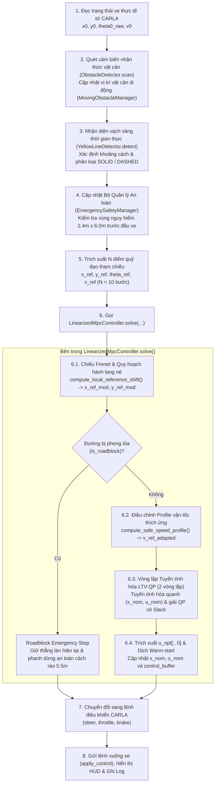

# TÀI LIỆU KỸ THUẬT CHI TIẾT: HỆ THỐNG ĐIỀU KHIỂN LINEARIZED MPC & NÉ VẬT CẢN TRÊN CARLA

Tài liệu này phân tích toàn diện mã nguồn của dự án **CARLA Autonomous MPC**, giải thích chi tiết từ kiến trúc phân tầng, luồng hoạt động của bộ điều khiển **Linearized MPC ([LinearizedMpcController](file:///home/tam-phuc/carla_simulator/Carla-Autonomous-MPC/src/linearized_mpc_controller.py))**, cấu trúc **Input / Output**, **Hàm chi phí (Cost Function)**, **Cơ chế nhận thức vạch vàng & 2 Chế độ an toàn**, **Thuật toán xử lý né đa tình huống & phanh dừng khẩn cấp (Roadblock Stop)**, cho đến ý nghĩa của toàn bộ các bộ thông số trong [src/config.py](file:///home/tam-phuc/carla_simulator/Carla-Autonomous-MPC/src/config.py).

---

## MỤC LỤC
1. [Tổng quan Kiến trúc Mã nguồn](#1-tổng-quan-kiến-trúc-mã-nguồn)
2. [Luồng Hoạt động Chi tiết của Hệ thống & Bộ Linearized MPC](#2-luồng-hoạt-động-chi-tiết-của-hệ-thống--bộ-linearized-mpc)
3. [Chi tiết Input và Output của Bộ điều khiển Linearized MPC](#3-chi-tiết-input-và-output-của-bộ-điều-khiển-linearized-mpc)
4. [Mô hình Động học & Thuật toán Tuyến tính hóa Lặp (LTV-MPC)](#4-mô-hình-động-học--thuật-toán-tuyến-tính-hóa-lặp-ltv-mpc)
5. [Giải thích Chi tiết Hàm Chi phí (Cost Function) & Hệ Ràng buộc](#5-giải-thích-chi-tiết-hàm-chi-phí-cost-function--hệ-ràng-buộc)
6. [Quá trình Nhận thức & Thuật toán Xử lý Né Đa Tình huống](#6-quá-trình-nhận-thức--thuật-toán-xử-lý-né-đa-tình-huống)
7. [Cơ chế Phanh Dừng Khẩn cấp Phong tỏa Đường (Roadblock Stop)](#7-cơ-chế-phanh-dừng-khẩn-cấp-phong-tỏa-đường-roadblock-stop)
8. [Giải thích Chi tiết Toàn bộ Thông số trong src/config.py](#8-giải-thích-chi-tiết-toàn-bộ-thông-số-trong-srcconfigpy)

---

## 1. Tổng quan Kiến trúc Mã nguồn

Hệ thống được thiết kế theo kiến trúc phân tầng chuẩn của xe tự hành (**Perception -> Safety Manager -> Local Planning -> MPC Control -> Actuation**):

| File mã nguồn | Vai trò chính trong hệ thống |
| :--- | :--- |
| src/main.py| **Vòng lặp điều khiển chính (10Hz)**: kết nối CARLA, đọc trạng thái xe, gọi camera nhận diện vạch vàng, quét cảm biến vật cản, cập nhật 2 chế độ an toàn, gọi bộ giải MPC và gửi tín hiệu điều khiển xuống xe. |
| src/config.py | **Trung tâm cấu hình hợp nhất**: tham số xe, trọng số hàm chi phí MPC, cấu hình cảm biến, hình học S-Curve né vật cản, nhận diện vạch vàng, 2 chế độ khẩn cấp và Cockpit Dashboard. |
| src/linearized_mpc_controller.py | **Bộ điều khiển cốt lõi (LMPC)**: Quy hoạch đường bao né vật cản cục bộ trên hệ tọa độ Frenet, bộ điều tốc an toàn, xử lý dừng Roadblock và bộ giải **Successive Linearization QP-MPC** với biến bù mềm (Slack Variables) và ràng buộc biên pháp lý động. |
| src/yellow_line_detector.py | **Nhận diện vạch vàng thời gian thực**: Trích xuất ảnh Front-cam, biến đổi không gian mắt chim (IPM), lọc màu HSV, thuật toán Sliding Window phân loại vạch liền (SOLID) / vạch đứt (DASHED) kết hợp CARLA Map Ground Truth. |
| src/emergency_safety.py | **Bộ quản lý an toàn 2 chế độ**: Quản lý Chế độ 1 (Bám đường né vật cản theo MPC) và Chế độ 2 (Phanh gấp khẩn cấp cực đại bỏ qua mọi ràng buộc khi vật cản di động xâm nhập vùng nguy hiểm trước đầu xe). |
| src/obstacle_detector.py| **Cảm biến nhận thức ảo**: Tính điểm gần nhất trên hộp bao định hướng 2D (OBB), quét đa vùng (FOV 120° phía trước + 360° cự ly gần) và duy trì bản đồ vật cản có nhớ (`tracked_obstacles`). |
| src/create_obstacles/obstacle_generator.py | Quản lý spawn vật cản tĩnh cố định từ file data/obstacles.csv và vật cản di động từ data/moving_obstacles.csv. |
| src/camera_viewer.py | Cockpit Dashboard đa màn hình: Chase Cam chính, Bird-Eye View, Front Hood Cam nhận diện vạch vàng và 2 đồ thị đo đạc thời gian thực (Telemetry). |
| src/help_functions.py | Hàm bổ trợ toán học & quỹ đạo: nạp CSV, tìm waypoint gần nhất, trích xuất đoạn tham chiếu N bước và tính sai số bám đường. |
| src/carla_simulator.py | Giao tiếp CARLA Server: spawn xe, lấy trạng thái, chuyển đổi gia tốc/góc lái sang `(steer, throttle, brake)` và vẽ đồ họa 3D debug. |
| src/logger.py | Ghi nhận dữ liệu từng chu kỳ và xuất 6 biểu đồ đánh giá chất lượng điều khiển vào thư mục `plots/`. |

---

## 2. Luồng Hoạt động Chi tiết của Hệ thống & Bộ Linearized MPC

### 2.1. Sơ đồ tổng thể vòng lặp điều khiển chính ([src/main.py](file:///home/tam-phuc/carla_simulator/Carla-Autonomous-MPC/src/main.py))

Ở mỗi chu kỳ lấy mẫu `dt = 0.1s` (tần số 10Hz), hệ thống thực hiện tuần tự 8 bước khép kín:



---

## 3. Chi tiết Input và Output của Bộ điều khiển Linearized MPC

### 3.1. Đầu vào (Inputs) của hàm `LinearizedMpcController.solve()`

Hàm `solve(self, x_init, x_ref, y_ref, theta_ref, v_ref, detected_obstacles=None)` nhận 6 tham số:

| Tên biến Input | Kiểu dữ liệu & Shape | Đơn vị | Nguồn cung cấp & Ý nghĩa chi tiết |
| :--- | :--- | :--- | :--- |
| `x_init` | `np.ndarray (4,)` | [m, m, rad, m/s] | Vector trạng thái thực tế hiện tại của xe: `[x0, y0, theta0, v0]`. Trong đó `theta0` đã được chuẩn hóa liên tục theo `theta_ref[0]`. |
| `x_ref` | `np.ndarray (N,)` | m | Tọa độ X của N = 10 waypoint tham chiếu phía trước, nội suy theo vận tốc thực tế của xe. |
| `y_ref` | `np.ndarray (N,)` | m | Tọa độ Y của N = 10 waypoint tham chiếu tương ứng. |
| `theta_ref` | `np.ndarray (N,)` | rad | Góc tiếp tuyến của đường đi tại N điểm tham chiếu (đã unwrap góc liên tục). |
| `v_ref` | `np.ndarray (N,)` | m/s | Vận tốc mục tiêu tại N điểm tham chiếu (tối đa 10.0 m/s trên đường thẳng, tự động giảm khi vào cua). |
| `detected_obstacles` | `list[dict]` | Đa đơn vị | Danh sách từ điển vật cản do `ObstacleDetector.scan()` cung cấp (`id`, `x`, `y`, `center_x`, `center_y`, `extent_x`, `extent_y`, `box_yaw`, `dist`, `d_long`, `d_lat`). |

---

### 3.2. Đầu ra (Outputs) của Bộ điều khiển & Chấp hành CARLA

1. **Đầu ra trực tiếp của `LinearizedMpcController.solve()`**:
   * `wheel_angle_rad` (góc bánh lái trước $\delta_0^*$, đơn vị rad): Giới hạn trong `[-1.2217, +1.2217] rad` (±70°).
   * `acceleration_m_s_2` (gia tốc dọc $a_0^*$, đơn vị m/s²): Giới hạn trong `[-4.1, +10.0] m/s²`.

2. **Chuyển đổi sang lệnh điều khiển CARLA (`CarlaSimulator.process_control_inputs`)**:
   * **Kiểm soát lực kéo khởi hành (Traction Control)**: Nếu $v < 1.5\text{ m/s}$, kẹp gia tốc trần $\le 2.5\text{ m/s²}$ để chống xoáy bánh sau.
   * **Kênh Ga (`throttle`)**: Khi $a > 0 \implies \text{throttle} = \min(a / 10.0, 1.0), \text{brake} = 0.0$.
   * **Kênh Phanh (`brake`)**: Khi $a \le 0 \implies \text{throttle} = 0.0, \text{brake} = \min(|a| / 4.1, 1.0)$.
   * **Kênh Lái (`steer`)**: $\text{steer} = \text{clip}(\delta / \delta_{\max}, -1.0, +1.0)$.

---

## 4. Mô hình Động học & Thuật toán Tuyến tính hóa Lặp (LTV-MPC)

### 4.1. Mô hình Động học Xe đạp Rời rạc (Kinematic Bicycle Model)

Với chu kỳ lấy mẫu `dt = 0.1s` và chiều dài cơ sở xe `L = 2.875m`:

$$p_{x, k+1} = p_{x, k} + v_k \cos(\theta_k) \Delta t$$
$$p_{y, k+1} = p_{y, k} + v_k \sin(\theta_k) \Delta t$$
$$\theta_{k+1} = \theta_k + \frac{v_k}{L} \tan(\delta_k) \Delta t$$
$$v_{k+1} = v_k + a_k \Delta t$$

### 4.2. Khai triển Taylor Bậc 1 Quanh Quỹ đạo Danh định

Tại mỗi bước dự đoán $k = 0 \dots N-1$, mô hình được tuyến tính hóa quanh trạng thái danh định $(\bar{x}_k, \bar{u}_k) = (\text{x\_nom}[:, k], \text{u\_nom}[:, k])$:

$$X_{:, k+1} = A_k X_{:, k} + B_k U_{:, k} + d_k$$

Trong đó ma trận trạng thái $A_k$, ma trận điều khiển $B_k$, và phần dư affine $d_k$ được tính toán giải tích:
$$A_k = \begin{bmatrix} 1 & 0 & -\bar{v}_k \sin(\bar{\theta}_k)\Delta t & \cos(\bar{\theta}_k)\Delta t \\ 0 & 1 & \bar{v}_k \cos(\bar{\theta}_k)\Delta t & \sin(\bar{\theta}_k)\Delta t \\ 0 & 0 & 1 & \frac{\tan(\bar{\delta}_k)}{L}\Delta t \\ 0 & 0 & 0 & 1 \end{bmatrix}, \quad B_k = \begin{bmatrix} 0 & 0 \\ 0 & 0 \\ \frac{\bar{v}_k}{L \cos^2(\bar{\delta}_k)}\Delta t & 0 \\ 0 & \Delta t \end{bmatrix}$$
$$d_k = f(\bar{x}_k, \bar{u}_k) - (A_k \bar{x}_k + B_k \bar{u}_k)$$

---

## 5. Giải thích Chi tiết Hàm Chi phí (Cost Function) & Hệ Ràng buộc

### 5.1. Bảng Phân tích 10 Thành phần trong Hàm Chi phí

Hàm mục tiêu toàn diện được tối ưu hóa ở mỗi bước QP:

$$J = \sum_{k=0}^{N-1} \Big( J_{x,k} + J_{y,k} + J_{v,k} + J_{\theta,k} + J_{\text{lat},k} + J_{\delta,k} + J_{a,k} + J_{\Delta\delta,k} + J_{\Delta a,k} \Big) + \sum_{k=0}^{N-1} J_{\text{road\_slack}, k}$$

| STT | Thành phần | Công thức trong Code | Trọng số (`config.py`) | Ý nghĩa Vật lý & Tác dụng Điều khiển |
| :-: | :--- | :--- | :--- | :--- |
| **1** | $J_{x,k}$ | `FINE_X_COEF * (X[0, k] - x_ref[k])**2` | `20.0` | Phạt sai số tọa độ X toàn cục, định vị tiến độ xe dọc đường. |
| **2** | $J_{y,k}$ | `FINE_Y_COEF * (X[1, k] - y_ref[k])**2` | `20.0` | Phạt sai số tọa độ Y toàn cục (luôn bằng trọng số X để đẳng hướng). |
| **3** | $J_{v,k}$ | `q_v * (X[3, k] - v_ref[k])**2` | `25.0` (Bình thường)<br/>**`120.0` (Roadblock)** | Phạt sai số vận tốc. Khi Roadblock, trọng số được nâng vọt lên 120.0 để ép hãm phanh triệt để theo profile an toàn. |
| **4** | $J_{\theta,k}$ | `FINE_THETA_COEF * (X[2, k] - theta_ref[k])**2` | `30.0` | Phạt sai số góc hướng mũi xe (giảm chấn góc, nắn thẳng mũi xe khi nhập làn). |
| **5** | $J_{\text{lat},k}$ | `FINE_LATERAL_COEF * (lat_dev ** 2)` | `30.0` | Phạt độ lệch ngang vuông góc với đoạn đường tham chiếu (Cross-Track Error). |
| **6** | $J_{\delta,k}$ | `FINE_STEER_COEF * (U[0, k] ** 2)` | `40.0` | Phạt biên độ góc bánh lái, giúp xe có xu hướng tự trả thẳng lái. |
| **7** | $J_{a,k}$ | `FINE_ACC_COEF * (U[1, k] ** 2)` | `4.0` | Phạt biên độ gia tốc dọc để tiết kiệm công điều khiển ga/phanh. |
| **8** | $J_{\Delta\delta,k}$ | `FINE_STEER_DOT_COEF * (U[0,k] - U[0,k-1])**2` | `2000.0` | Phạt tốc độ bẻ lái giữa các bước dự đoán để triệt tiêu hiện tượng giật vô lăng. |
| **9** | $J_{\Delta a,k}$ | `r_acc_dot * (U[1,k] - U[1,k-1])**2` | `180.0` (Bình thường)<br/>**`45.0` (Roadblock)** | Phạt độ giật dọc Jerk ($da/dt$). Khi Roadblock, giảm nhẹ xuống 45.0 để cho phép lực phanh phản ứng kịp thời. |
| **10**| $J_{\text{road}}$ | Phạt biến bù biên mặt đường $\varepsilon_{\text{road}, k}$ | `500000 * eps^2 + 50000 * eps` (SOLID)<br/>`8000 * eps^2 + 800 * eps` (DASHED) | Phạt cực nặng nếu xe đè hoặc vượt qua vạch vàng nét liền bên trái. |

---

### 5.2. Hệ Ràng buộc (Constraints) & Hành lang Biên Pháp lý Động

1. **Ràng buộc điều kiện đầu**: $X_{:, 0} = x_{\text{init}}$.
2. **Ràng buộc động học tuyến tính hóa**: $X_{:, k+1} = A_k X_{:, k} + B_k U_{:, k} + d_k$.
3. **Ràng buộc cơ khí chấp hành**:
   * $|\delta_k| \le 1.2217\text{ rad}$ (±70°).
   * $-4.1\text{ m/s²} \le a_k \le +10.0\text{ m/s²}$.
4. **Ràng buộc vận tốc**:
   * $0.0 \le v_k \le 15.0\text{ m/s}$ (khi Roadblock hoặc dừng).
   * $\min(v_0, 1.5) \le v_k \le 15.0\text{ m/s}$ (khi chạy bình thường, chống dừng khựng/lùi xe).
5. **Ràng buộc Hành lang Biên Pháp lý cho Tâm xe (Legal Corridor Bounds)**:
   * Mép đường vật lý là `DEFAULT_ROAD_HALF_WIDTH_M = 5.25m`.
   * Trừ đi bán kính an toàn thân xe $r_{\text{clearance}} = 1.0\text{m (nửa xe)} + 0.35\text{m (lề)} = 1.35\text{m}$:
     * **Biên phải tối đa cho tâm xe**: `road_max = 5.25 - 1.35 = +3.90m` (chống sườn xe leo lên vỉa hè mép phải).
     * **Biên trái tối đa khi vạch đứt (DASHED)**: `road_min = -5.25 + 1.35 = -3.90m`.
     * **Biên trái tối đa khi vạch liền (SOLID)**: `road_min = max(-3.90m, -1.75 + 1.35) = -0.40m` (cấm tuyệt đối đè vạch vàng sang làn đối diện).

---

## 6. Quá trình Nhận thức & Thuật toán Xử lý Né Đa Tình huống

### 6.1. Nhận diện Vạch vàng Thời gian thực ([src/yellow_line_detector.py](file:///home/tam-phuc/carla_simulator/Carla-Autonomous-MPC/src/yellow_line_detector.py))
* Front Camera thu nhận khung hình RGB từ nắp ca-pô xe.
* Thực hiện phép biến đổi hình học phối cảnh nghịch đảo (IPM) chuyển vùng ROI sang góc nhìn mắt chim (Bird-Eye View - BEV) với tỷ lệ $3.5\text{ cm/px}$ ngang và $5.0\text{ cm/px}$ dọc.
* Lọc ngưỡng màu vàng trong không gian HSV (`H: 12-38`, `S: 40-255`, `V: 70-255`).
* Chạy 10 cửa sổ trượt (Sliding Windows) fit đa thức bậc 2 xác định vị trí vạch vàng theo khoảng cách Frenet $d_{\text{yellow}}$.
* Phân loại:
  * Tỷ lệ lấp đầy $\ge 75\% \implies$ **SOLID (Vạch liền, cấm vượt)**.
  * Tỷ lệ ngắt quãng $\ge 30\% \implies$ **DASHED (Vạch đứt, cho phép mượn làn khi cần)**.

---

### 6.2. Quy hoạch Đường né S-Curve Thích ứng ([src/linearized_mpc_controller.py](file:///home/tam-phuc/carla_simulator/Carla-Autonomous-MPC/src/linearized_mpc_controller.py))

1. **Chiếu Frenet & Tạo mặt cắt ngang**:
   * Chiếu toàn bộ vật cản lên trục Frenet `(s, d)`. Mỗi vật cản đóng góp một khoảng cấm ngang:
     $$\text{blocked} = [d_{\min} - r_{\text{clearance}}, \; d_{\max} + r_{\text{clearance}}], \quad r_{\text{clearance}} = 1.0\text{m} + 0.35\text{m} = 1.35\text{m}$$
2. **Tìm khe trống tự do (`find_free_gaps_in_corridor`)**:
   * Tìm các khe hở khả dụng trong phạm vi `[road_min, road_max]` có bề rộng $\ge 0.20\text{m}$ (tương ứng bề rộng vật lý mặt đường $\ge 3.0\text{m}$).
3. **Quy tắc chọn khe né tự nhiên (Thuần tự hành, không cần cấu hình thủ công)**:
   * Tâm khe mục tiêu: $d_{\text{cand}} = \text{clip}(0.0, g_{\text{low}} + \text{pad}, g_{\text{high}} - \text{pad})$ với $\text{pad} = 0.15\text{m}$.
   * **Luật giao thông chuẩn (Right-Hand Traffic)**:
     * Khe lấn vạch vàng sang làn đối diện ($d < \text{yellow\_limit}$) chịu phạt nặng `+0.85`.
     * Khe lệch sang bên trái ($d < -0.05\text{m}$) chịu phạt nhẹ `+0.15` để **luôn luôn tự nhiên ưu tiên né sang PHẢI**.
     * Giữ tính liên tục của hành lang né (phạt `+1.50` nếu đổi bên đột ngột để chống lắc ziczac).
     * Khi vạch vàng là **SOLID**, biên trái bị khóa cứng ở `-0.40m`, xe chỉ được né phải hoặc dừng Roadblock.
4. **Hàm trọng số S-Curve Cosine 4 pha (`calc_span_obstacle_weight`)**:
   * Dốc mở lái êm: `OBSTACLE_APPROACH_RAMP_M = 18.0m`.
   * Khoảng đệm hoàn tất mở lái trước đuôi vật cản: `OBSTACLE_APPROACH_MARGIN_M = 2.5m`.
   * Khoảng đệm giữ làn sau khi vượt qua vật cản: `OBSTACLE_HOLD_DISTANCE_M = 4.0m`.
   * Dốc trả lái êm về tim đường: `OBSTACLE_RETURN_RAMP_M = 16.0m`.

---

## 7. Cơ chế Phanh Dừng Khẩn cấp Phong tỏa Đường (Roadblock Stop)

Khi toàn bộ bề rộng mặt đường bị bít kín (không còn khe trống hợp pháp $\ge 0.20\text{m}$), cờ `self.is_roadblock = True` được kích hoạt:

```text
[MPC DECISION - DỪNG LẠI (STOP)] ROADBLOCK_STOP | dist=13.6m | 
VẠCH VÀNG NÉT LIỀN BÊN TRÁI (d=1.75m) CẤM VƯỢT + LÀN PHẢI BỊ CHẶN tại s=134.0m. 
Không còn khe trống hợp pháp trong [-0.40m, +3.90m]; dừng xe an toàn!
```

### 7.1. Logic Định hướng Hành lang Dừng (Ngăn đánh lái sai khi dừng)
* **Nếu xe đang chạy thẳng ở tim đường (`|d_ego| <= 0.6m`)**:
  * Hủy toàn bộ các dốc né `corridor_groups = []`.
  * Gán `hold_corridor_d = 0.0`.
  * Quỹ đạo tham chiếu giữ thẳng tắp theo tim đường ban đầu.
  * **Xe giữ thẳng lái tuyệt đối (`steer = 0.0°`) và phanh dừng thẳng ngay trên tim đường**, không lách sang bên rồi mới phanh.
* **Nếu xe đã lách hẳn sang làn né (`|d_ego| > 0.6m`)**:
  * Gán `hold_corridor_d = d_ego` kéo dài qua rào cản.
  * **Xe tiếp tục đi thẳng trên làn né hiện tại và dừng lại**, tuyệt đối không kéo giật về tim đường đâm vào đuôi vật cản trước.

### 7.2. Profile Giảm tốc Động học & Cự ly Dừng An toàn
* Cự ly dừng mục tiêu từ cản trước xe tới vật cản: `ROADBLOCK_SAFE_STOP_DISTANCE_M = 5.5m` (mũi xe cách vật cản 3.5 - 4.0m rất thoáng và an toàn).
* Profile vận tốc giảm dần mượt mà theo gia tốc hãm `ROADBLOCK_DECELERATION_M_S_2 = 1.6 m/s²`:
  $$v_{\text{target}}(k) = \sqrt{2 \cdot 1.6 \cdot d_{\text{stop}}(k)}$$
* Khi $d_{\text{stop}} \le 0.25\text{m}$ hoặc $v < 0.25\text{ m/s}$, bộ điều khiển chốt trạng thái dừng hoàn toàn: xuất lệnh `steer = 0.0`, đạp phanh tối đa `acc = -3.5 m/s²` (`brake = 1.0`).

---

## 8. Giải thích Chi tiết Toàn bộ Thông số trong `src/config.py`

### 8.1. Nhóm Đường dẫn Dữ liệu & Kết nối CARLA (Dòng 5–23)

| Tên hằng số | Giá trị | Đơn vị | Ý nghĩa & Tác dụng |
| :--- | :--- | :--- | :--- |
| `TRAJECTORY_CSV_PATH` | `data/reference_trajectory.csv` | File | File CSV chứa quỹ đạo chuẩn `(x, y, theta_rad, v_m_s)`. |
| `OBSTACLES_CSV_PATH` | `data/obstacles.csv` | File | File CSV chứa danh sách vật cản tĩnh cố định `(x, y, size)`. |
| `MOVING_OBSTACLES_CSV_PATH` | `data/moving_obstacles.csv` | File | File CSV chứa hành trình của vật cản di động. |
| `OBSTACLE_SIZE` | `0.5` | m | Kích thước hiển thị khối hộp vật cản. |
| `CARLA_HOST` | `'127.0.0.1'` | IP | Địa chỉ máy chủ CARLA Server. |
| `CARLA_PORT` | `2000` | Port | Cổng TCP kết nối CARLA. |

---

### 8.2. Nhóm Vận tốc, Động học Xe & Chân trời MPC (Dòng 25–51)

| Tên hằng số | Giá trị | Đơn vị | Ý nghĩa & Tác dụng |
| :--- | :--- | :--- | :--- |
| `TARGET_SPEED_MS` | `10.0` | m/s | Vận tốc hành trình mong muốn khi đường thoáng (36.0 km/h). |
| `L` | `2.875` | m | Chiều dài cơ sở xe Tesla Model 3 trong CARLA. |
| `N` | `10` | Bước | Độ dài chân trời dự đoán (10 bước $\times 0.1\text{s} = 1.0\text{s}$). |
| `dt` | `0.1` | s | Chu kỳ lấy mẫu và điều khiển thời gian thực (10Hz). |
| `MAX_ACCELERATION_M_S_2` | `10.0` | m/s² | Gia tốc cực đại để chuẩn hóa mở bướm ga `throttle`. |
| `MAX_BRAKING_M_S_2` | `-4.1` | m/s² | Gia tốc hãm phanh cực đại để chuẩn hóa lực phanh `brake`. |
| `MAX_WHEEL_ANGLE_RAD` | `70.0°` (1.22 rad) | rad | Góc quay bánh lái tối đa để chuẩn hóa góc lái `steer`. |
| `FINE_X_COEF` / `FINE_Y_COEF` | `20.0` / `20.0` | Trọng số | Phạt sai số tọa độ X, Y bám quỹ đạo tham chiếu. |
| `FINE_V_COEF` | `25.0` | Trọng số | Phạt sai số vận tốc dọc đường. |
| `FINE_THETA_COEF` | `30.0` | Trọng số | Phạt sai số góc hướng mũi xe (giảm chấn góc lái khi nhập làn). |
| `FINE_LATERAL_COEF` | `30.0` | Trọng số | Phạt sai số lệch ngang vuông góc với tim đường (Cross-Track Error). |
| `FINE_STEER_COEF` | `40.0` | Trọng số | Phạt biên độ góc lái, giúp vô lăng tự trả thẳng. |
| `FINE_ACC_COEF` | `4.0` | Trọng số | Phạt biên độ gia tốc để xe tăng/giảm tốc êm ái. |
| `FINE_STEER_DOT_COEF` | `2000.0` | Trọng số | Phạt tốc độ bẻ lái $(\delta_k - \delta_{k-1})^2$ để triệt tiêu giật lắc vô lăng. |
| `FINE_ACC_DOT_COEF` | `180.0` | Trọng số | Phạt độ giật dọc Jerk $(a_k - a_{k-1})^2$ để phanh/ga không bị nhấp nhả. |

---

### 8.3. Nhóm Vật cản Tĩnh Cố định & Vật cản Di động (Dòng 55–86)

| Tên hằng số | Giá trị | Đơn vị | Ý nghĩa & Tác dụng |
| :--- | :--- | :--- | :--- |
| `ENABLE_OBSTACLES` | `True` | Boolean | Bật spawn vật cản tĩnh cố định từ `data/obstacles.csv`. |
| `OBSTACLE_PREVIEW_DURATION_SEC` | `60.0` | s | Thời gian xem trước khi chạy script độc lập `obstacle_generator.py`. |
| `STATIC_OBSTACLE_BLUEPRINTS` | `['vehicle.toyota.prius']` | List | Blueprint 3D Actor dùng để spawn vật cản tĩnh. |
| `ENABLE_MOVING_OBSTACLES` | `True` | Boolean | Bật spawn và điều khiển vật cản di động từ `data/moving_obstacles.csv`. |
| `MOVING_OBSTACLE_SPEED_MS` | `9.0` | m/s | Vận tốc di chuyển của vật cản động (~32.4 km/h). |
| `MOVING_OBSTACLE_LOOP` | `False` | Boolean | `False`: Dừng lại ở waypoint cuối; `True`: Chạy lặp vòng tròn. |

---

### 8.4. Nhóm Cảm biến Nhận thức & Hình học Thân xe (Dòng 90–121)

| Tên hằng số | Giá trị | Đơn vị | Ý nghĩa & Tác dụng |
| :--- | :--- | :--- | :--- |
| `SENSOR_DETECTION_RANGE_M` | `28.0` | m | Tầm quét tầm xa phía trước mũi xe (Vùng 1). |
| `SENSOR_FOV_DEG` | `120.0` | Độ | Góc mở trường nhìn phía trước mũi xe (±60° mỗi bên). |
| `SENSOR_SURROUND_RANGE_M` | `10.0` | m | Bán kính quét 360° cự ly gần bảo vệ sườn và đuôi xe (Vùng 2). |
| `SENSOR_TRACK_DROP_BEHIND_M` | `3.0` | m | Khoảng cách sau lưng xe để xóa vật cản khỏi bộ nhớ `tracked_obstacles`. |
| `OBSTACLE_SPATIAL_CLUSTER_RANGE_M` | `6.5` | m | Khoảng cách dọc tối đa để gộp các vật cản gần nhau vào 1 mặt cắt ngang. |
| `DEFAULT_ROAD_HALF_WIDTH_M` | `5.25` | m | Nửa bề rộng mặt đường vật lý CARLA (tính từ tim đường ra mép vỉa hè). |
| `EGO_HALF_WIDTH_M` | `1.0` | m | Nửa chiều rộng thân xe Ego (bề rộng thân xe 2.0m). |
| `EGO_FRONT_OVERHANG_M` | `2.4` | m | Khoảng cách từ tâm xe tới cản trước (mũi xe). |
| `EGO_REAR_OVERHANG_M` | `2.4` | m | Khoảng cách từ tâm xe tới cản sau (đuôi xe). |
| `OBSTACLE_AVOIDANCE_MARGIN_M` | `0.35` | m | Khoảng đệm an toàn dự phòng ngoài mép thân xe. |
| `OBSTACLE_CAUTION_SPEED_MS` | `6.0` | m/s | Vận tốc an toàn thích ứng khi lách qua vật cản (~21.6 km/h). |
| `OBSTACLE_SLOWDOWN_DISTANCE_M` | `15.0` | m | Khoảng cách trước vật cản bắt đầu rà giảm tốc êm. |
| `OBSTACLE_TRIGGER_LATERAL_CORRIDOR_M` | `2.0` | m | Hành lang độ lệch ngang so với tim đường (|d| ≤ 2.0m) để kích hoạt né. |

---

### 8.5. Nhóm 2 Chế độ Điều khiển & Phanh Dừng Roadblock (Dòng 124–148)

| Tên hằng số | Giá trị | Đơn vị | Ý nghĩa & Tác dụng |
| :--- | :--- | :--- | :--- |
| `ENABLE_EMERGENCY_BRAKE_MODE` | `True` | Boolean | Bật cơ chế chuyển đổi 2 chế độ điều khiển tự động. |
| `EMERGENCY_ZONE_WIDTH_M` | `2.4` | m | Độ rộng vùng nguy hiểm trước đầu xe (±1.2m quanh trục dọc). |
| `EMERGENCY_ZONE_LENGTH_M` | `6.0` | m | Chiều dài vùng nguy hiểm tính từ cản trước về phía trước. |
| `EMERGENCY_CLEAR_HOLD_TIME_SEC` | `2.0` | s | Thời gian duy trì đường trống trước khi hoàn về Chế độ 1. |
| `EMERGENCY_TRIGGER_ONLY_MOVING` | `True` | Boolean | Chỉ kích hoạt Chế độ 2 phanh gấp khi gặp vật cản di động cắt ngang đầu xe. |
| `ENABLE_ROADBLOCK_EMERGENCY_STOP` | `True` | Boolean | Bật tự động phanh dừng khẩn cấp khi toàn bộ mặt đường bị phong tỏa. |
| `ROADBLOCK_SAFE_STOP_DISTANCE_M` | `5.5` | m | Khoảng cách dừng an toàn từ cản trước mũi xe tới vật cản chắn đường. |
| `ROADBLOCK_DECELERATION_M_S_2` | `1.6` | m/s² | Gia tốc giảm tốc mục tiêu giúp xe hãm phanh êm từ xa, không trôi sát vật cản. |
| `OBSTACLE_APPROACH_RAMP_M` | `18.0` | m | Chiều dài dốc mở lái Cosine S-Curve tiếp cận êm, không ngoặt gắt. |
| `OBSTACLE_APPROACH_MARGIN_M` | `2.5` | m | Khoảng đệm hoàn tất 100% độ lệch ngang trước khi mũi xe chạm đuôi vật cản. |
| `OBSTACLE_HOLD_DISTANCE_M` | `4.0` | m | Khoảng đệm giữ làn sau khi đuôi xe vượt qua mũi vật cản. |
| `OBSTACLE_RETURN_RAMP_M` | `16.0` | m | Chiều dài dốc trả lái Cosine S-Curve êm ái về tim đường, triệt tiêu vọt lố. |

---

### 8.6. Nhóm Cockpit Dashboard & Nhận diện Vạch vàng (Dòng 152–240)

| Tên hằng số | Giá trị | Đơn vị | Ý nghĩa & Tác dụng |
| :--- | :--- | :--- | :--- |
| `ENABLE_CHASE_CAMERA_WINDOW` | `True` | Boolean | Bật cửa sổ Cockpit Dashboard đa màn hình Pygame. |
| `COCKPIT_WINDOW_WIDTH` / `HEIGHT` | `1440` / `900` | px | Kích thước tổng thể cửa sổ Dashboard (tỷ lệ 16:10). |
| `ENABLE_SPECTATOR_FOLLOW` | `True` | Boolean | Camera Spectator trong cửa sổ chính CARLA tự động bay bám sau xe. |
| `ENABLE_YELLOW_LINE_DETECTOR` | `True` | Boolean | Bật module nhận diện vạch vàng thời gian thực (HSV + IPM + Sliding Window). |
| `YELLOW_LINE_CLEARANCE_M` | `0.35` | m | Khoảng cách an toàn tối thiểu từ mép sườn xe tới vạch vàng nét liền. |
| `YELLOW_SOLID_FILL_RATIO` | `0.75` | Tỷ lệ | Ngưỡng lấp đầy ≥ 75% phân loại vạch vàng nét liền (SOLID - cấm vượt). |
| `YELLOW_DASHED_GAP_RATIO` | `0.30` | Tỷ lệ | Ngưỡng ngắt quãng ≥ 30% phân loại vạch vàng nét đứt (DASHED - cho phép vượt). |
