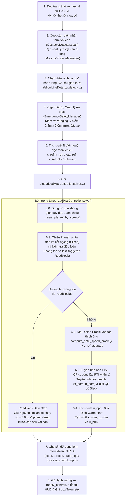

# TÀI LIỆU KỸ THUẬT CHI TIẾT: HỆ THỐNG ĐIỀU KHIỂN LINEARIZED MPC & NÉ VẬT CẢN TRÊN CARLA

Tài liệu này phân tích toàn diện mã nguồn của dự án **CARLA Autonomous MPC**, giải thích chi tiết từ kiến trúc phân tầng, luồng hoạt động của bộ điều khiển **Linearized MPC ([LinearizedMpcController](file:///home/tam-phuc/carla_simulator/Carla-Autonomous-MPC/src/linearized_mpc_controller.py))**, cấu trúc **Input / Output**, **Hàm chi phí (Cost Function)**, **Cơ chế nhận thức vạch vàng & 2 Chế độ an toàn**, **Thuật toán xử lý né đa tình huống & phong tỏa đường so le (Staggered Roadblock Stop)**, cho đến ý nghĩa của toàn bộ các bộ thông số trong [src/config.py](file:///home/tam-phuc/carla_simulator/Carla-Autonomous-MPC/src/config.py).

---

## MỤC LỤC
1. [Tổng quan Kiến trúc Mã nguồn](#1-tổng-quan-kiến-trúc-mã-nguồn)
2. [Luồng Hoạt động Chi tiết của Hệ thống & Bộ Linearized MPC](#2-luồng-hoạt-động-chi-tiết-của-hệ-thống--bộ-linearized-mpc)
3. [Chi tiết Input và Output của Bộ điều khiển Linearized MPC](#3-chi-tiết-input-và-output-của-bộ-điều-khiển-linearized-mpc)
4. [Mô hình Động học & Thuật toán Tuyến tính hóa Lặp (LTV-MPC)](#4-mô-hình-động-học--thuật-toán-tuyến-tính-hóa-lặp-ltv-mpc)
5. [Giải thích Chi tiết Hàm Chi phí (Cost Function) & Hệ Ràng buộc](#5-giải-thích-chi-tiết-hàm-chi-phí-cost-function--hệ-ràng-buộc)
6. [Quá trình Nhận thức & Thuật toán Xử lý Né Đa Tình huống](#6-quá-trình-nhận-thức--thuật-toán-xử-lý-né-đa-tình-huống)
7. [Cơ chế Phanh Dừng Khẩn cấp Phong tỏa Đường (Staggered Roadblock Stop)](#7-cơ-chế-phanh-dừng-khẩn-cấp-phong-tỏa-đường-staggered-roadblock-stop)
8. [Giải thích Chi tiết Toàn bộ Thông số trong src/config.py](#8-giải-thích-chi-tiết-toàn-bộ-thông-số-trong-srcconfigpy)

---

## 1. Tổng quan Kiến trúc Mã nguồn

Hệ thống được thiết kế theo kiến trúc phân tầng chuẩn của xe tự hành (**Perception -> Safety Manager -> Local Planning -> MPC Control -> Actuation**):

| File mã nguồn | Vai trò chính trong hệ thống |
| :--- | :--- |
| [src/main.py](file:///home/tam-phuc/carla_simulator/Carla-Autonomous-MPC/src/main.py) | **Vòng lặp điều khiển chính (10Hz)**: kết nối CARLA, đọc trạng thái xe, gọi camera nhận diện vạch vàng & hành lang CV, quét cảm biến vật cản, cập nhật 2 chế độ an toàn, gọi bộ giải MPC và gửi tín hiệu điều khiển xuống xe. |
| [src/config.py](file:///home/tam-phuc/carla_simulator/Carla-Autonomous-MPC/src/config.py) | **Trung tâm cấu hình hợp nhất**: tham số xe, trọng số hàm chi phí MPC, cấu hình cảm biến, hình học S-Curve né vật cản, nhận diện vạch vàng (HSV + thông số camera vật lý), 2 chế độ khẩn cấp và Cockpit Dashboard. |
| [src/road_corridor.py](file:///home/tam-phuc/carla_simulator/Carla-Autonomous-MPC/src/road_corridor.py) | **Hành lang mặt đường động (Dynamic Road Corridor)**: Đọc cấu trúc OpenDRIVE Map từ CARLA theo thời gian thực, xác định mép vỉa hè/hộ lan, vạch trắng liền sát mép phải, số làn cùng chiều bên trái/phải, xử lý mở rộng giao lộ và biên pháp lý `[road_min(s), road_max(s)] = [-0.45m, +3.90m]`. |
| [src/linearized_mpc_controller.py](file:///home/tam-phuc/carla_simulator/Carla-Autonomous-MPC/src/linearized_mpc_controller.py) | **Bộ điều khiển cốt lõi (LMPC)**: Quy hoạch đường bao né vật cản cục bộ trên hệ tọa độ Frenet, cơ chế Staggered Roadblock ($\Delta s < 17.3\text{m}$), chốt giữ phanh dừng `roadblock_latched_ids`, S-Curve có kẹp mở lái `min_s_app_start`, và bộ giải **Successive Linearization QP-MPC (RTI 1 vòng lặp ~45ms)** với biến bù mềm (Slack Variables). |
| [src/yellow_line_detector.py](file:///home/tam-phuc/carla_simulator/Carla-Autonomous-MPC/src/yellow_line_detector.py) | **Nhận diện vạch vàng & hành lang mặt đường thời gian thực (Classical CV)**: Trích xuất ảnh Front Hood-Cam (480x300), biến đổi không gian mắt chim giải tích (Analytic IPM), lọc HSV thích ứng, Sliding Window bám độ dốc phân loại vạch liền (SOLID) / vạch đứt (DASHED), nhận diện vạch trắng liền mép đường để kẹp đúng `+3.90m`. |
| [src/emergency_safety.py](file:///home/tam-phuc/carla_simulator/Carla-Autonomous-MPC/src/emergency_safety.py) | **Bộ quản lý an toàn 2 chế độ**: Quản lý Chế độ 1 (Bám đường né vật cản theo MPC) và Chế độ 2 (Phanh gấp khẩn cấp cực đại bỏ qua mọi ràng buộc khi vật cản di động xâm nhập vùng nguy hiểm trước đầu xe). |
| [src/obstacle_detector.py](file:///home/tam-phuc/carla_simulator/Carla-Autonomous-MPC/src/obstacle_detector.py) | **Cảm biến nhận thức ảo**: Tính điểm gần nhất trên hộp bao định hướng 2D (OBB), quét đa vùng (FOV 120° phía trước + 360° cự ly gần) và duy trì bản đồ vật cản có nhớ (`tracked_obstacles`). |
| [src/create_obstacles/obstacle_generator.py](file:///home/tam-phuc/carla_simulator/Carla-Autonomous-MPC/src/create_obstacles/obstacle_generator.py) | Quản lý spawn vật cản tĩnh cố định từ file `data/obstacles.csv` và vật cản di động từ `data/moving_obstacles.csv`. |
| [src/camera_viewer.py](file:///home/tam-phuc/carla_simulator/Carla-Autonomous-MPC/src/camera_viewer.py) | Cockpit Dashboard đa màn hình: Chase Cam chính (960x600), Bird-Eye View (480x300), Front Hood Cam nhận diện vạch kẻ (480x300) và 2 đồ thị đo đạc thời gian thực (Telemetry). |
| [src/help_functions.py](file:///home/tam-phuc/carla_simulator/Carla-Autonomous-MPC/src/help_functions.py) | Hàm bổ trợ toán học & quỹ đạo: nạp CSV, làm mịn profile vận tốc qua cua (khử hố kép), trích xuất đoạn tham chiếu N bước động theo độ dài cung. |
| [src/carla_simulator.py](file:///home/tam-phuc/carla_simulator/Carla-Autonomous-MPC/src/carla_simulator.py) | Giao tiếp CARLA Server: spawn xe, lấy trạng thái, chuyển đổi gia tốc/góc lái sang `(steer, throttle, brake)` với logic giới hạn phanh êm $0.12$ khi ôm cua và phanh đầy đủ khi đi thẳng/dừng Roadblock. |
| [src/logger.py](file:///home/tam-phuc/carla_simulator/Carla-Autonomous-MPC/src/logger.py) | Ghi nhận dữ liệu từng chu kỳ, tự động lưu file `plots/simulation_telemetry.csv` và xuất 6 biểu đồ đánh giá chất lượng điều khiển vào thư mục `plots/`. |

---

## 2. Luồng Hoạt động Chi tiết của Hệ thống & Bộ Linearized MPC

### 2.1. Sơ đồ tổng thể vòng lặp điều khiển chính ([src/main.py](file:///home/tam-phuc/carla_simulator/Carla-Autonomous-MPC/src/main.py))

Ở mỗi chu kỳ lấy mẫu `dt = 0.1s` (tần số 10Hz), hệ thống thực hiện tuần tự 8 bước khép kín:

---

## 3. Chi tiết Input và Output của Bộ điều khiển Linearized MPC

### 3.1. Đầu vào (Inputs) của hàm `LinearizedMpcController.solve()`

Hàm `solve(self, x_init, x_ref, y_ref, theta_ref, v_ref, detected_obstacles=None)` nhận 6 tham số:
- `x_init`: `[x0, y0, theta0, v0]`.
- `x_ref, y_ref, theta_ref, v_ref`: Các mảng $N$ bước được lấy mẫu đồng bộ theo vận tốc thực tế của xe.
- `detected_obstacles`: Danh sách vật cản có tọa độ OBB, cự ly, độ lệch ngang.

### 3.2. Đầu ra (Outputs) của Bộ điều khiển & Chấp hành CARLA
- `steer_rad`: Góc lái bánh trước $\delta_0^* \in [-1.2217, +1.2217]\text{ rad}$ ($\pm 70^\circ$).
- `acc_m_s2`: Gia tốc điều khiển $a_0^* \in [-4.1, +10.0]\text{ m/s}^2$.
- Hàm [`CarlaSimulator.process_control_inputs()`](file:///home/tam-phuc/carla_simulator/Carla-Autonomous-MPC/src/carla_simulator.py#L284-L314) chuyển đổi gia tốc sang `throttle`, `brake`, `steer`. Lưu ý đặc biệt: Khi xe đang đánh lái ôm cua (`abs(wheel_angle_rad) > 0.08`), phanh được đệm êm tối đa `brake <= 0.12` để chống bó cứng bánh gây mất lái; khi xe chạy thẳng hoặc dừng Roadblock, lực phanh đạt tối đa $1.0$.

---

## 4. Mô hình Động học & Thuật toán Tuyến tính hóa Lặp (LTV-MPC)

Mô hình động học xe đạp (Kinematic Bicycle Model):
$$\dot{x} = v \cos\theta, \quad \dot{y} = v \sin\theta, \quad \dot{\theta} = \frac{v}{L} \tan\delta, \quad \dot{v} = a$$

Tại mỗi chu kỳ, mô hình phi tuyến được tuyến tính hóa quanh quỹ đạo danh định Warm-start $(\bar{x}_k, \bar{u}_k)$:
$$x_{k+1} = A_k x_k + B_k u_k + d_k$$
với $d_k = f(\bar{x}_k, \bar{u}_k) - (A_k \bar{x}_k + B_k \bar{u}_k)$ là sai số phi tuyến bù chính xác.

---

## 5. Giải thích Chi tiết Hàm Chi phí (Cost Function) & Hệ Ràng buộc

Tại mỗi bước $k = 0 \dots N-1$:
$$J = \sum_{k=0}^{N-1} \Big( q_x (x_k - x_k^r)^2 + q_y (y_k - y_k^r)^2 + q_v (v_k - v_k^r)^2 + q_\theta (\theta_k - \theta_k^r)^2 + q_{\text{lat}} e_{\text{lat}, k}^2 + r_\delta \delta_k^2 + r_a a_k^2 + r_{\Delta \delta} (\Delta \delta_k)^2 + r_{\Delta a} (\Delta a_k)^2 \Big) + \text{Cost}_{\text{slack}}$$

- **Hành lang pháp lý động:**
  $$d_{\text{lat}, k} \le \text{road\_max} + \epsilon_{\text{right}, k}, \quad d_{\text{lat}, k} \ge \text{road\_min} - \epsilon_{\text{left}, k}$$
  Khi có vạch vàng nét liền, phạt biến bù $\epsilon_{\text{left}}$ lên tới **$25000 \cdot \epsilon^2 + 2500 \cdot \epsilon$**.
- **Siêu phẳng né vật cản (Linear Separating Hyperplane):**
  So sánh vị trí tham chiếu $d_{\text{ref}, k}$ với tâm vật cản $d_{\text{obs\_center}}$:
  $$\text{Nếu } d_{\text{ref}, k} > d_{\text{obs\_center}} \Rightarrow d_{\text{lat}, k} + \epsilon_k \ge d_{\text{max}} + 1.35\text{m}$$
  $$\text{Nếu } d_{\text{ref}, k} \le d_{\text{obs\_center}} \Rightarrow -d_{\text{lat}, k} + \epsilon_k \ge -d_{\text{min}} + 1.35\text{m}$$
  *(Tuyệt đối không so sánh với $0.0\text{m}$ để tránh lật ngược siêu phẳng của xe đỗ ở làn bên cạnh)*.

---

## 6. Quá trình Nhận thức & Thuật toán Xử lý Né Đa Tình huống

### 6.1. Ngưỡng phân loại vật cản
- Bán kính an toàn cơ sở: $r_{\text{clearance}} = W_{\text{half}} + d_{\text{margin}} = 1.00\text{m} + 0.35\text{m} = \mathbf{1.35\text{m}}$.
- Vùng chiếm dụng ngang của vật cản: $[d_{\text{min}} - 1.35\text{m}, d_{\text{max}} + 1.35\text{m}]$.
- **Vật cản cách tâm đường $\le 1.35\text{m}$ (`affects_lane = True`):** Chắn làn xe chạy $\Rightarrow$ **Kích hoạt né**.
- **Vật cản cách tâm đường $> 1.35\text{m}$ (`affects_lane = False`):** Nằm ở làn bên cạnh $\Rightarrow$ **Chạy thẳng, không né** ($d_{\text{target}} = 0.0\text{m}$).
- Khi né, tâm xe dịch cách mép vật cản: $1.35\text{m} + 0.15\text{m} = \mathbf{1.50\text{m}}$ ($0.50\text{m}$ lề ngoài sườn xe).

### 6.2. Ghép nối đường cong S-Curve 4 pha
- Mở lái: `OBSTACLE_APPROACH_RAMP_M = 18.0m`.
- Đệm trước mũi vật cản: `OBSTACLE_APPROACH_MARGIN_M = 2.5m`.
- Giữ độ lệch làn: `OBSTACLE_HOLD_DISTANCE_M = 4.0m`.
- Trả lái về tim đường: `OBSTACLE_RETURN_RAMP_M = 16.0m`.
- **Cụm vật cản cùng phía:** Gộp thành hành lang phẳng liền khối (Flat Outer Envelope), cấm trả lái ziczac giữa 2 xe đỗ gần nhau.

---

## 7. Cơ chế Phanh Dừng Khẩn cấp Phong tỏa Đường (Staggered Roadblock Stop)

### 7.1. Công thức khoảng cách dọc tối thiểu lách qua vật cản so le ($17.3\text{m}$)
Khi có 2 vật cản so le (Vật cản #1 ở Làn 4 bên phải, Vật cản #2 ở Làn 3 của xe Ego):
$$s_{\text{req}} = (L_f + L_r + d_{\text{margin}}) + \max(7.5,\; 4.0 \times \Delta d)$$
Với $\Delta d = 2.50\text{m}$ (chuyển làn từ Làn 3 sang Làn 4):
$$s_{\text{req}} = (2.4 + 2.4 + 2.5) + (4.0 \times 2.50) = 7.3 + 10.0 = \mathbf{17.3\text{m}}$$

### 7.2. Phán đoán và thực thi
1. **Nếu khoảng hở dọc thực tế $\Delta s < 17.3\text{m}$:**
   - Kích hoạt **`ROADBLOCK_STOP`** từ xa.
   - Xe Ego giữ nguyên vị trí tâm làn $d = 0.0\text{m}$ chạy thẳng qua bên trái Vật cản #1.
   - Hãm phanh êm ái dừng trước cản sau Vật cản #2 khoảng $5.5\text{m}$.
   - Khóa ID vật cản vào `self.roadblock_latched_ids` để chống nhả phanh giữa chừng.
2. **Nếu khoảng hở dọc thực tế $\Delta s \ge 17.3\text{m}$:**
   - Đủ cự ly lách qua an toàn.
   - Kẹp điểm bắt đầu mở lái S-Curve của Vật cản #2: $s_{\text{app\_start, 2}} \ge s_{\text{front, 1}} + L_r$ để xe thoát hẳn đuôi qua Vật cản #1 rồi mới đánh lái sang phải.

---

## 8. Giải thích Chi tiết Toàn bộ Thông số trong src/config.py

| Tên biến cấu hình | Giá trị | Ý nghĩa kỹ thuật |
| :--- | :--- | :--- |
| `TARGET_SPEED_MS` | $10.0\text{ m/s}$ ($36\text{ km/h}$) | Tốc độ hành trình mục tiêu trên đường thẳng. |
| `OBSTACLE_CAUTION_SPEED_MS` | $6.0\text{ m/s}$ ($21.6\text{ km/h}$) | Tốc độ an toàn khi đi ngang sườn vật cản. |
| `N` | $10$ | Độ dài chân trời dự đoán MPC ($1.0\text{s}$ ở $10\text{Hz}$). |
| `dt` | $0.1\text{ s}$ | Chu kỳ trích mẫu điều khiển. |
| `L` | $2.875\text{ m}$ | Chiều dài cơ sở xe Tesla Model 3. |
| `EGO_FRONT_OVERHANG_M` | $2.4\text{ m}$ | Trọng tâm đến mép cản trước. |
| `EGO_REAR_OVERHANG_M` | $2.4\text{ m}$ | Trọng tâm đến mép cản sau. |
| `EGO_HALF_WIDTH_M` | $1.0\text{ m}$ | Nửa bề rộng thân xe. |
| `OBSTACLE_AVOIDANCE_MARGIN_M` | $0.35\text{ m}$ | Khoảng đệm an toàn sườn xe. |
| `ROADBLOCK_SAFE_STOP_DISTANCE_M`| $5.5\text{ m}$ | Cự ly dừng an toàn trước vật cản phong tỏa. |
| `ROADBLOCK_DECELERATION_M_S_2` | $1.6\text{ m/s}^2$ | Gia tốc hãm phanh êm khi dừng Roadblock. |
| `YELLOW_LINE_CLEARANCE_M` | $0.35\text{ m}$ | Khoảng đệm an toàn tối thiểu tránh chém vạch vàng. |
